# 5. 국가과학기술표준분류체계(과학기술정보통신부고시)(제2025-60호)(20251216)

> 원문: `5. 국가과학기술표준분류체계(과학기술정보통신부고시)(제2025-60호)(20251216).hwp` — HWPML 자동 변환. 내용 생략·요약 없음, 표는 마크다운 표로 재구성(병합셀은 빈 칸으로 펼침).

국가과학기술표준분류체계

[시행 2025. 12. 16.] [과학기술정보통신부고시 제2025-60호, 2025. 12. 16., 일부개정.]

> 국가과학기술표준분류체계

| 법제처 | - / - | 국가법령정보센터 |
|---|---|---|

과학기술정보통신부(과학기술정보분석과), 044-202-6967

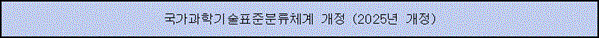

<details><summary>이미지 OCR 텍스트 (tesseract 자동인식 · 미검증 — 원문은 위 이미지)</summary>

```text
국가과학기술표준문류체계 개정 (2025년 개정)
```

</details>

1. 연구분야

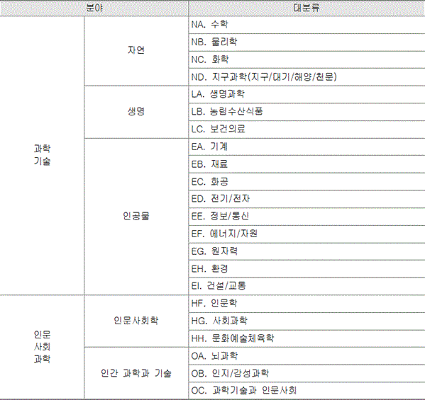

<details><summary>이미지 OCR 텍스트 (tesseract 자동인식 · 미검증 — 원문은 위 이미지)</summary>

```text
CO On RM Oe ee
NA. 수학
NB. 물리학
NC. 화학
140. 지구과확(지구/대기/해양/천문)
LA. 생명과학
생명         Ｌ8. 농림수산식품
Lo, 보건의료
과학                           EA. 기계
기술                           68. 재료
Ec. 화공
60. 전기/전자
cE. 정보/통신
EF. 에너지/자원
EG, 원자력
타1. 환경
El. 건설/교통
HF. 인문학
인문사회학      HG. 사회과학
wal                           HH. 문화예술체육학
과학                           OA, 뇌과학
인간 과학과 기술 OB, 인지/감성과학
OC, 과학기술과 인문사회
```

</details>

□ 자연

NA. 수학

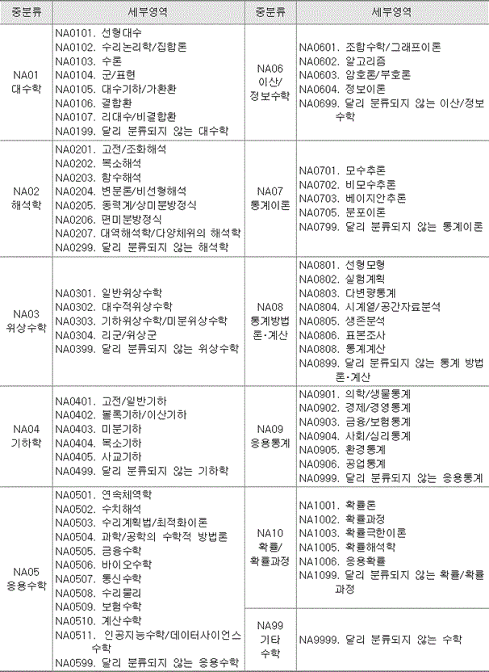

<details><summary>이미지 OCR 텍스트 (tesseract 자동인식 · 미검증 — 원문은 위 이미지)</summary>

```text
NAOION. 선형대수
NAO102. 수리논리학/집합론                40601. 조합수학/그래프이론
NAO103. 수론                   4406  NA0602, 알고리즘
NAO] |NAOQI04. 군/표현                 이사/ 60603. 암호론/부호론
대수학 |NAOIO5. 대수기하/가환환        정보수학 |0604. 정보이론
NAO106. 결함환                    그 그 INA0699. 달리 분류되지 않는 이산/정보
NAO107. 리대수/비결함환                       수학
NAOI99. 달리 분류되지 않는 대수학
NA0201. 고전/조화해석
새어 oss                        NAO701, 모수추론
.   TT                                     >
NAO2 |NAO204, 변분론/비선형해석          NAOT 아아아 wloIShe
해석학 |NA0205. 동력계/상미문방정식       SANE 5 부포이론
NA0206. 편미문방정식                         oS
NAO207. 대역해석학/다양체위의 해석학        80799. 달리 분류되지 않는 SAME
NA0299, 달리 SRSA 않는 해석학
440801. 선형 모형
NAO802, 실험계획
NAO301. 일반위상수학                    NA0803. CHA SSI
NAOS  NAO302. 대수적위상수학            NAOS |NA0804, 시계열/공간자료분석
위상수학 "0303. 기하위상수학/미분위상수학 | SAY |440605. 생존문석
그 그 :티0304. 리군/위상군           론ㆍ계산 |NAO8O6. 표본조사
NAO399. Se] 분류되지 않는 위상수학        NAO808, 통계계산
40899, 달리 분류되지 않는 통계 방법
Bait
NAOAOI. 고전/일반기하                  채비 stays sty
NA0402, #2 181/01 A171 St                40909. 금융/보험통계
NAO4 |NAO403. 미문기하                4409  N 0904. 사회 /실리통계
기하학 |NAO4O4. 복소기하             SSSA | 000 화경통계
NAO405. 사교기하         ：           40906, 공업롱계
10499. 달리 문류되지 않는 기하학          60999. 달리 분류되지 않는 SBSH
NA05O1. 연속체역학
40502. 수치해석                       NAI001. SBE
NAO5O3. 수리계획법/최적화이론             NA1002. 확률과정
NA05O4, 과학/공학의 수학적 방법론 | NAIO |4441003. SBOE
NA0505, 금융수학                 확플/ (NA1005, Sts 2!
NA0506. 바이오수학              확률과정 |NA1006. 중용확률
NAOS | NAOSO7, 통신수학                       NA1099. 달리 문류되지 않는 확률/확률
2  ~        ㆍ   —
SSF a0sos. 수리물리                         과정
40509. 보험수학
NAO510, 계산수학                  499
NAOSTT BENS RAUGIOINOLS   DIE} | NAQOO9. 달리 분류되지 않는 수학
ㅜ                       수학
NAOSO9. 달리 분류되지 않는 응용수학 | 、
```

</details>

NB. 물리학

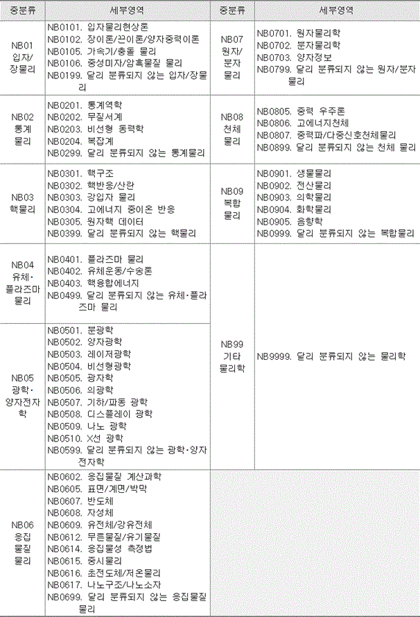

<details><summary>이미지 OCR 텍스트 (tesseract 자동인식 · 미검증 — 원문은 위 이미지)</summary>

```text
중분류            세부영역           SSR |          세무영역
460101. 입자물리현상론                            ~
NBO102, 장이론/끈이론/양자중력이론 | 607 |N80?01. Brecis
4601           이      =                  NBO702. 분자물리학
60105. 가속기/충돌 물리            원자/
입자/                 ce        분자 |NBO703. 양자정보
Bea |NB0106. 증성미자/앙축물잘 Sel       =o, 60799. 달리 분류되지 않는 원자/분자
60199. 달리 분류되지 않는 입자/장물| 물리        애리
리
NBO201. 통계역학                                 x
NBO2 |NB0202, 무질서계                NBOS  Neoooe nae
통계 |NBO203, 비선형 동력학            M44 오이 이어라 라볼선추전체불리
=                                「         ㆍ         |  Al
물리 NB0204. 복잡계                 Sel 60899. 달리 분류되지 않는 천체 물리
60299. 달리 분류되지 않는 통계물리              ee       ==
NBO3O1. 핵구조                          NBO901. 생물물리
60302. 핵반응/산란              600 80902 전산물리
NBO3 |NBO303. 강입자 물리              복합 "80903. 의학물리
핵물리 」460304. 고에너지 중이온 반응       물리   "80904. 화학물리
60305. 원자핵 데이터              =    60905. 음향학
60399. 달리 분류되지 않는 핵물리          60999. 달리 분류되지 않는 복함물리
60401. 플라즈마 물리
ou, 1460402. 유체운동/수송론
eo) x0} 60403. 핵응합에너지
oj 60499. 달리 문류되지 않는 유체*플라
=          즈마 물리
460501. 분광학
NBO502. 양자광학                 4699
60503. 레이저광학               기타 |489999. 달리 분류되지 않는 물리학
NB0504, 비선형광학               물리학
NBOS |NBOSOS, 광자학
광학ㆍ 60506. 의광학
양자전자 |NBOSO?. 기하/파동 광학
학  |160508. 디스플레이 광학
60509. 나노 광학
60510. %선 광학
60599. 달리 문류되지 않는 광학ㆍ양자
전자학
60602. 응집물질 계산과학
60605. 표면/계면/박막
60607. 반도체
60608. 자성체
NBO6 |NBOSO9. 유전체/강유전체
응집 _ 60612. 무른물질/유기물질
물질 _460614. 응집물성 측정법
물리 |NBO615. 중시물리
60616. 초전도체/저온물리
NBO617, 나노구조/나노소자
NBO699. SA] SRSA 않는 옹집물질
물리
```

</details>

NC. 화학

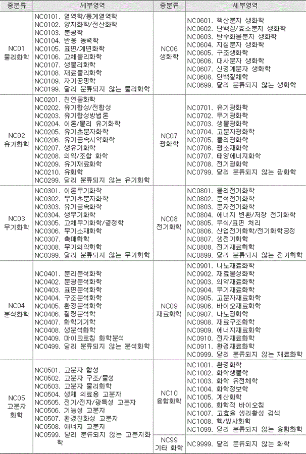

<details><summary>이미지 OCR 텍스트 (tesseract 자동인식 · 미검증 — 원문은 위 이미지)</summary>

```text
SER            세부영역           세부영역
40101. 열역학/통계열역학                        사뿌자 4
NCO102. 양자화학/전산화학                 나 Chile 생화학
NCO103. 분광학 오스히르보
버러                         NCO603, 탄수화물분자 생화학
NC0104, 반응 동력학                   60604. 지질분자 생화학
NCO] |NCO105. 표면/계면화학             NCOB |icggos, 구조생화학
물리화학 60106. 고체물리화학             BSH | 0606. 대사분자 생화학
00107. 생물리화학                     40607. 신경계분자 생화학
NCO108. 재료물리화학                    460608. 단백질체학
NCO109. 자기공명학                    NC0699. 달리 분류되지 않는 생화학
(60199. 달리 분류되지 않는 물리화학              :     =     es
NC0201. 천연물화학
NC0202, 유기함성/전함성                 NCO701. 유기광화학
NC0203. 유기함성방법론                  60702. 무기광화학
NC0204, 이론/물리 유기화학              60703. 생물광화학
Neog |NC0205. 유기초분자화학            neo? |NCO?704. 고문자광화학
유기화학 "60206. 유기금속시약화학         광화학 NCO705. 물리광화학
NCO207. 생유기화학                       NCO706, 광소재화학
NC0208. 의약/조합 화학                    NCO707. 태양에너지화학
NC0209, 유기재료화학                    60708. 전기광화학
NCO210. 유화학                       NC0799. 달리 문류되지 않는 광화학
NC0299. 달리 문류되지 않는 유기화학
40301. 이론무기화학                   40801. 물리전기화학
NC0302. 무기초분자화학                  NC0802. 문석전기화학
NC0303. 유기금속화학                   NCO803. 분자전기화학
603 |NCO304. 생무기화학               608 |NC0804. 에너지 변환/저장 전기화학
무기화학 00905. 고체무기화학/결정학       전기화학 "00605. 부식/표면 처리
NCO306. 무기소재화학             본      60806. 산업전기화학/전기화학공정
NCO307. 촉매화학                      40807. 생전기화학
40308. 무기의약화학                    40808. 전기재료화학
40399. 달리 분류되지 않는 무기화학        NCO899. 달리 분류되지 않는 전기화학
60901. 나노재료화학
NCO401. 분리분석화학                    NC0902, 재료물성화학
40402. 분광분석화학                    NCO903, 의약재료화학
40403. 표면분석화학                   NCO904, 무기재료화학
NC0404, 구조분석화학                   NCO905. 고분자재료화학
NCO4 (NCO405. 환경분석화학              NCO9 |NCO906. 바이온재료화학
분석화학 (60406. 질량분석학           재료화학 40907. 나노광화학
NCO407. 화학기기학                       NCO908, 재료구조화학
NCO408, 생분석화학                      60909. 에너지재료화학
NC0409, 마이크로침 화학분석              NCO910. 전자재료화학
NC0499, 달리 분류되지 않는 분석화학        NCOQ11, 환경재료화학
NCO999, 달리 문류되지 않는 재료화학
A
NCO501. 고분자 함성                    비어002. carats
NC0502. 고분자 구조/물성                 NC1003. 화학 유전체학
NC0503. 고분자 물리화학                  NC1004, 화학정보학
4606 |NC0504. 생체 의료용 고분자         NC1O 21005. 계산화학
고분자 NC050S. 전기/전자/광특성 고분자    SUSI | C1006. 히학적 바이오칩
화학 0206. ISS 고분자                  61007. D&S 생리활성 검색
10507, 환경친화성 고분자                 NC1008, 핵/방사화학
NCO508. 에녀지 고분자                  NC1099. 달리 문류되지 않는 응합화학
NC0599. 달리 문듀되지 않는 고분자화 ~ …-~ ~
브       안느
학                     기타 화학 "9999. 달리 분류되지 않는 화학
```

</details>

ND. 지구과학(지구/대기/해양/천문)

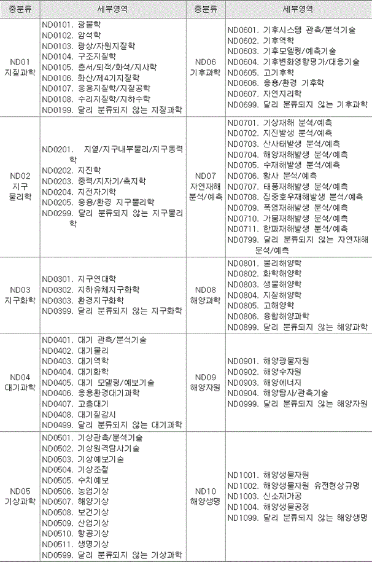

<details><summary>이미지 OCR 텍스트 (tesseract 자동인식 · 미검증 — 원문은 위 이미지)</summary>

```text
SEF           세무영역
NDOIO!. 광물학                         4100601. 기후시스템 관측/분석기술
00102, 앙석학                       NDO602, 기후역학
me sas                   ND0603. 기후모델링/예측기술
Noor |NDOIO. 구조지폴락         4006 |400604. 기후변화영향평가/대응기술
NDOIOS. 층서/퇴적/화석/지사학           ,             :
지질과학                       기후과학 |400605. 고기후학
NDOIO6. 화산/제4기지질학
NDO606. 응용/환경 기후학
NDO107. 응용지질학/지질공학
es                     NDO6O7, 자연지리학
00108. 수리지질학/지하수학              아오이 Gal Semin 이니 이조가한
00199. 달리 SSI 않는 지질과학              aa &     ==
NDO701. 기상재해 분석/예측
00702. 지진발생 분석/예측
0”                00703. 산사태발생 문석/예측
00705. 수재해발생 분석/예측
NDO2  티드 sone panies         NDO? |NDO7O6. 황사 문석/예측
자구 다이아 적자기하          자연재해 |400707. 태풍재해발생 분석/예측
물리학        . 지형                  분석/예측 00708. 집중호우재해발생 분석/예측
NDO205. 응용/환경 지구물리학             니00209 폭영재해발생 분석/예족
NDO299. 달리 분류되지 않는 지구물리             1 그리세베레래 때기
s                           00710. 가뭉재해발생 분석/예측
NDO711. 한파재해발생 분석/예측
00799. 달리 문쥬되지 않는 자연재해
분석/예측
00801. 물리해양학
tz   13
00301. 지구연대학                       디디 어문래안하
4003 |NDO3O2. 지하유체지구화학           0 나 스전해양학
지구화학 |NDO3O3. 환경지구화학          SVD 이 그래야학
00899. 달리 분류되지 않는 해양과학
00401. 대기 관측/분석기술
00402. 대기물리
00403. 대기역학                       00901. 해양광물자원
0 |NDO404. 대기화학                Nog 00902, 해양수자원
chor ayer |NDO405. 대기 모델링/예보기술      syerniay 400903. 해양에너지
00406. 응용환경대기과학                 00904. 해양탕사/관측기술
00407. 고층대기                      00999. 달리 분류되지 않는 해양자원
00408. 대기질감시
00499. 달리 분류되지 않는 대기과학
00501. 기상관측/분석기술
00502. 기상원격탕사기술
00503. 기상예보기술
Neoree 수                        ND1001. 해양생물자원
ㆍ ㅠㅜ                                      생물지    저
4005 |NDOS06. 놓업기상               4010 |B loos eeets 유전헌상규명
기상과학 |NDO507. 해양기상           해아 서영 | Heese
NDO508. 보건기상                       401099. 달리 분류되지 않는 해양생명
NDO509. 산업기상                              ：     ~        ~
NDO510. 항공기상
00511. 생명기상
00599. 달리 분쥬되지 않는 기상과학
```

</details>

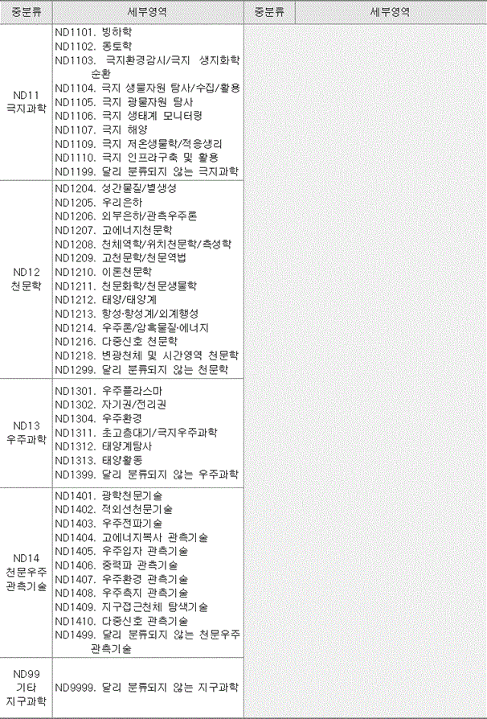

<details><summary>이미지 OCR 텍스트 (tesseract 자동인식 · 미검증 — 원문은 위 이미지)</summary>

```text
SEF            MESS           세무영역
ND1101. 빙하학
ND1102. 동토학
ND1103. 극지환경감시/극지 생지화학
순환
NDI   ND1104. 극지 생물자원 탐사/수집/활용
극지과학 ND1105. 극지 광물자원 탐사
그      ND1106. 극지 생태계 모니터링
ND1107. 극지 해양
ND1109. 극지 져온생물학/적응생리
ND1110. 극지 인프라구축 및 활용
ND1199. Sel SRSA] 않는 극지과학
ND1204. 성간물질/별생성
ND1205. 우리은하
ND1206. 외부은하/관측우주론
ND1207. DOUALA Set
ND1208. 천체역학/위치천문학/측성학
ND1209. 고천문학/천문역법
NDI2 (ND1210. 이론천문학
천문학 ND1I211. 천문화학/천문생물학
ND1212. 태양/태양계
ND1213. 항성항성계/외계행성
ND1214. 우주론/암흑물질에너지
ND1216. 다중신호 천문학
ND1218. 변광천체 및 시간영역 천문학
ND1299. 달리 SRSA 않는 천문학
ND1301. 우주플라스마
ND1302. 자기권/전리권
ND13  ND1304. 우주환경
우주과학 ND1311. 초고층대기/극지우주과학
주    ND1312. 태양계탐사
ND1313. 태양활동
ND1399. 달리 SRSA] 않는 우주과학
ND1401. 광학천문기솔
ND1402. 적외선천문기술
ND1403. 우주전파기술
ND1404. 고에너지복사 관측기솔
N14  ND1405. 우주입자 관측기솔
천문우주 ND1406. 중력파 관측기술
과측기술 \NDI407. 우주환경 BHI
노기    ND1408. 우주측지 관측기술
ND1409. 지구접근천체 탐색기술
ND1410. 다중신호 관측기솔
ND1499. 달리 문류되지 않는 천문우주
관측기술
ND99
기타 =|ND9999. 달리 SRSA 않는 지구과학
지구과학
```

</details>

□ 생명

LA. 생명과학

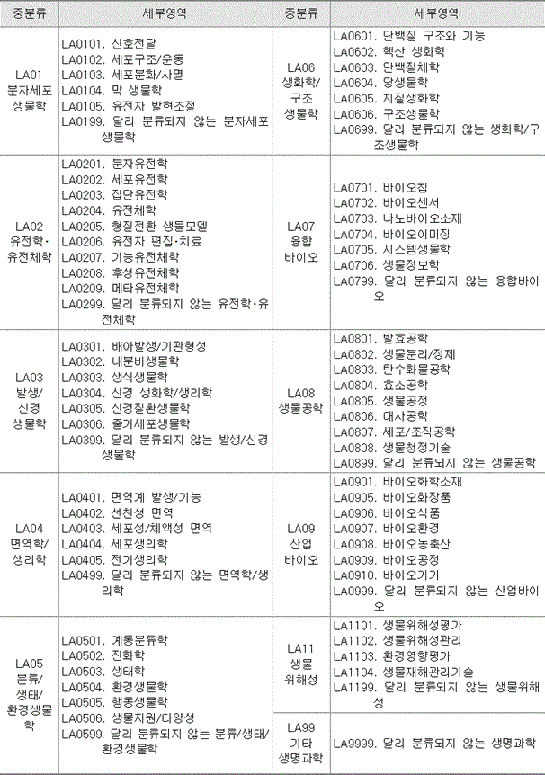

<details><summary>이미지 OCR 텍스트 (tesseract 자동인식 · 미검증 — 원문은 위 이미지)</summary>

```text
Ｌㄴ60601. 단백질 구조와 기능
LAOION. USGS                       LAQ6O2. 핵산 생화학
Ｌㄴ40102. 세포구조/운동                                 변
내                     LAO6 |ㄴ40603. 단백질체학
분자세포 |ㄴ60104, 막 생물학      were
생물학 |LAOIOS. 유전자 발현조절            =   LADGOS, 지질생화학
40199. 달리 분류되지 않는 Ene) SSS LAM. 이기 weeny 않는 생환학/구
생물학                               조생물학       7
LA0201, 문자유전학
LA0202, 세포유전학
십                                    40701. 바이오침
60203, Genes                       LAO702. 바이오센서
60204, 유전체학 ie                   ㄴ40703. 나노바이오소재
LAO2 ㄴ0205., 형질전환 생물모델         LAO7 | 20764. 바이오이미징
유전체학 |ㄴ40207. 기능유전체학            바이오 | 0706, 생물정보학
60208. 후성유전체학                    0799. 달리 분류되지 않는 응합바이
LA0209, 메타유전체학                    La   2    =       =
LA0299. 달리 문류되지 않는 유전학ㆍ유
전체학
LAO3O1, 배아발생/기관형성                 60601. 발효송학
chara                     LA0SO2. 생물문리/정제
=                         LA0803. 탄수화물공학
LAOS |ㄴ60303, 생식생물학                     40804. HABE!
wey ㄴ40304. 신경 생화학/생리학          LAOS 6 생물공정
신경 |ㄴ60305. 신경질환생물학           생물공학       : 으르
주                 =                    LAOSO6. 대사공학
생물학 ：ㄴ0306, 줄기세포생물학             LAO8O7, 세포/조직공학
루        안느 받샌/시                      ;       ~
8 브리 분듀되지 않는 발생/신경           Ｌㄴ40808. 생물청정기술
=                         LA0899, 달리 분류되지 않는 생물공학
Ｌㄴ60901. 바이오화학소재
LA0401, 면역계 발생/기능                  Ｌㄴ40905. 바이오화장품
LA0402, 선천성 면역                    Ｌㄴ40906. 바이오식품
LAO4 |LA0403, 세포성/체액성 면역          LAOS /|LAO907. 바이오환경
면역학/ |ㄴ&0404. 세포생리학                산업 _|ㄴ40908. 바이오농축산
생리학 ㅣㄴ60405. 전기생리학               바이오 ㅣㄴ&0909. 바이오공정
LA0499, 달리 분류되지 않는 면역학/생         LAOSI0. 바이오기기
리학                         Ｌㄴ60999. 달리 분류되지 않는 산업바이
오
ㄴ&1101. 생물위해성평가
LA05O1, 계롱분휴학                 LAM   LA1102. 생물위해성관리
LAOS   LA0502, 진화학                    생물   LA1103. 환경영향평가
=m, |LA0SOS. 생태학                  위 해성  LA1104, 생물재해관리기솔
생태/  Ｌㄴ60504. 환경생물학                   LAII99. 달리 SRSA 않는 생물위해
건 | 40505. 행동생물학                            성
내 ㄴ&0506. 생물자원/다양성         | Age
부       앙느 SRA
50599. 발리 ERSIN BS 분류/생태/   기타 _|ㄴ69999. 달리 분류되지 않는 생명과학
환경생물학                생명과학
```

</details>

LB. 농림수산식품

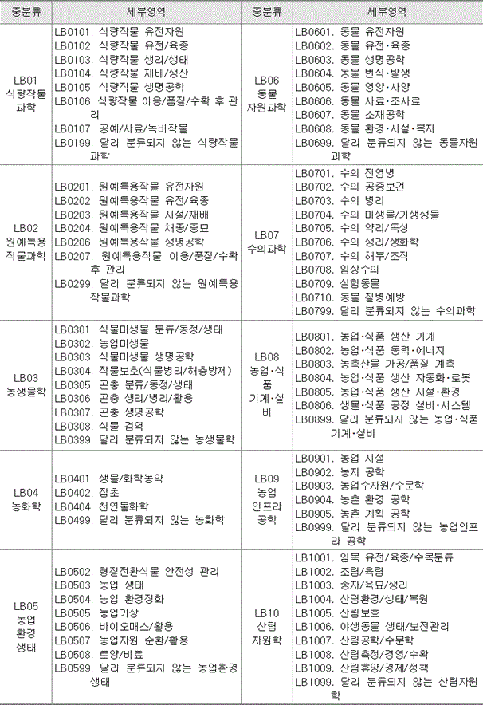

<details><summary>이미지 OCR 텍스트 (tesseract 자동인식 · 미검증 — 원문은 위 이미지)</summary>

```text
MESS
부           물 유전자원
  0601. 동물 aos
부영역                       80602. 동물 생명공학
eal   자원               80803. 동물 번식:발생
중분듀      80004. $= 영왕-사양
LBO102. warns 매해          Se  네타 se pene  복지
chorea 식량작물 eee      oY xsi ape LBO607. == 한혀ㆍ시얼-액지 종물자원
아보 Alea Teper        poses 몰리 분류머지 알는
0801 60105. 식량작물 이                   60699. 버
식량작물 | B01  이     녹비작물 식랑작물          가" 전염병
과학     107. a eee 않는 4            LB0701. 수의 공중보건
pols, 말리 분                 아이 수이 뱅이    생물
18019 과학                           80703. 수의 미생물/기생생물
작물 유전자원             LB0704. 소이 약리/ vores
예득용작물  전/육종              0705. 수  생리/생화
60201. 아아 오자르 eae         07   ceovoe 주의 해무/조직
60202,  예록용작물 재종/종묘      min   0707. iat
0203. 원   용작물 x    학      나   6. 임상수
»  [80204 aoleacte 18/ee/ 구화         Bov08, Se eos 않는 수의과학
LB      0206.       작물                       . 종률 질   지 않는
ase 18020. 8am   | 않는 wuss       0 ea =F   기계
작물과          | 분류되지 않는                        -식품 생산    지
60008 드리기                         80801. be 식품 『코/품전 계측
：         문류/동정/생태           80009. SEAN 생산 Nea
식물미생물 분               608   eens 놓업ㆍ식품 ioe wees
LB0301. 놓업미생물    공학        고어 시 | Bosoa, 농업ㆍ식품  정 ea
50909. aiecieess 생영 /해총방제) | 동연:   Te 않는 놓업ㆍ식
60303. agsecega/        기계ㆍ설  LB0806. 해 분류되지 않는
60304. 고주 해 oe           비    ee a
L608  00900. 곤충 oes                            시설
0306. 곤  ^
sees ‘Boo? 곤충 no     는 농생물학        60901, a 공학   문학
180309. 식물 경   지 않는 S             oie
60399.                     나   나 수초 화려 SF 않는 seem
물/화학농약           인프라  60905. 농  THA 않는
LBO401. 생물/화                 "공학   60999. ote      수목문류
4 |LB0402. no ene  | 않는 농화학                “as alli
sam 60004 Sat                 om aaa.
농화   60499.                            LB1002. SAVRG/S
LB1003. 산림환경/생태/목
환식물 안전성 관리            ee 산림보호 생태/보전관리
, 형질전                         LB1005.  생동물 생태
LB0502 =O} 생태                LB10    1006, OF   학/수문학
Eres, 도연 환경정화           sae: 81007. 산원종 /경영/수확
LB0504, ar    2           자원학  때 산령/콩제정록 산림자원
놓업   60506,    자원 순                      1099.
환경 | 220 오악 베른    않는 종업환경        내   학
```

</details>

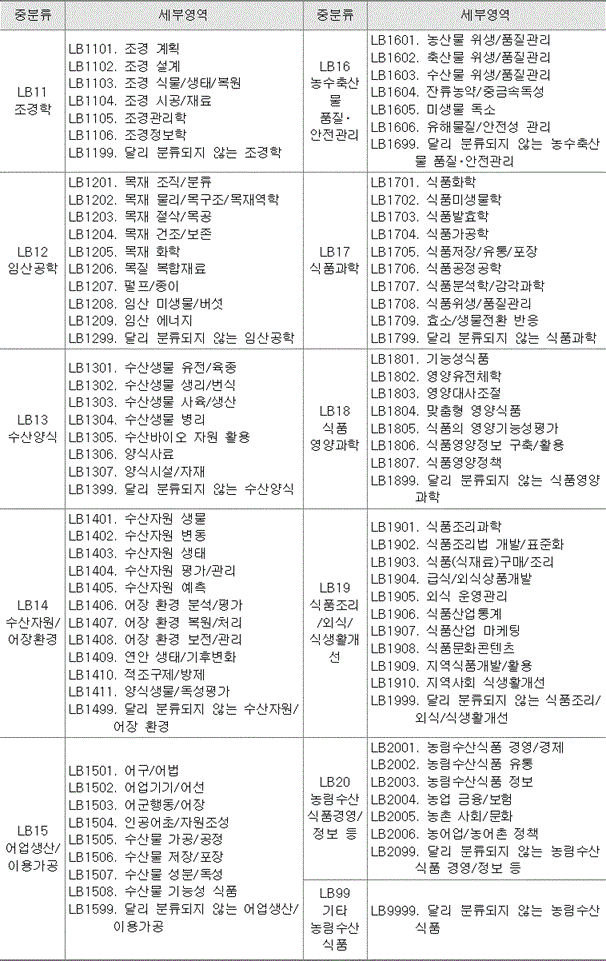

<details><summary>이미지 OCR 텍스트 (tesseract 자동인식 · 미검증 — 원문은 위 이미지)</summary>

```text
Sef           세쿠영역
LB1601. 농산물 위생/품질관리
x
ello, st ay               cig (81802. 축산물 위생/품질관리
81103. 조경 식물/생태/복원        농수축산 1603. FOS 위생/품질관리
느 |[61104. 조경 B/E          = |LB1604, 잔류놓약/중금속독성
조경학       _                       = |LB1605. 미생물 독소
61105. 조경관리학               품질ㆍ           .
81199. 달리 분류되지 않는 조경학 | 01699. 달리 분류되지 않는 농수축산
'     “     네드 후                   몰 품질ㆍ안전관리
LB1201. 목재 조직/문휴                  61701. 식품화학
LB1202, 목재 물리/목구조/목재역학          61702. 식품미생물학
81203, 목재 절삭/목공                   61703, 식품발효학
61204. 목재 건조/보존                  61704. 식품가공학
LB12 |LB1205. 목재 화학                0617 |LB1705. 식품저장/유통/포장
임산공학 61206. 목질 목합재료          식품과학 61706. 식품공정공학
81207. 펄프/종이                       LB1707. 식품문석학/감각과학
LB1208, 임산 미생물/버섯                  LB1708. 식품위생/품질관리
LB1209, 임산 에너지                      LB1709. 효소/생물전환 반응
81299. 달리 분류되지 않는 임산공학         61799. 달리 문류되지 않는 식품과학
LB1301. 수산생물 유전/육중                61601, 기등성직종
LB1302, 수산생물 생리/번식                61602, eee
81303. 수산생물 사육/생산               181803, SSaNss
” 스사샌드    더       1618 |LB1804. 맞춤형 영양식품
[613 |LB1304. 수산생물 병리              시           AlZo
수산양식 |LB1305, 수산바이오 자원 활용         식품 |ㄴ61805. 식품의 영양기능성명가
181306, 양식사료             영양과학 61806. 식품영양정보 구축/활용
.                                    A
LB1307. 양식시설/자재                  61807, A ee ea
plane, aieial ere                   LB1901, 식품조리과학
16140. 수산자원 생대                   61902. 식품조리법 Ww RSS
81404, 수산자원 평가/관리               LB1903, 식품(식재료)구매/조리
(81405. 수산지원 예측 _           1819 81904. 급식/외식상품개발
°  ~     ~                         Al 우
1614 61406. 어장 환경 문석/평가        식품조리 노트 mane,
SAIIS/|LB1407, 어장 환경 복원/처리        (1 | 21007. 식품산업 마케팅
어장환경 61408. 어장 환경 보전/관리       식생활개      eos aeys
LB1409, 연안 생태/기후변화           선 | 1006. 석응룬화론텐츠
(81410. 적조구제/방제              LB1909. 지역식품개발/활용
81411. 양식생물/독성평가                 LB1910. 지역사회 식생활개선
 ei emer) 안느 스            61999. 달리 문류되지 않는 식품조리/
61499. 달리 문휴되지 않는 수산자원/             외식/식생활개선
어장 환경                                        딜      =
62001. 농림수산식품 경영/경제
62002. 농림수산식품 유통
LB1501, 어구/어법
LB1502, 어업기기/어선             [620 |ㄴㅁㅁ2003. 놓림수산식품 정보
LB1503, 어군행동/어장            농림수산 62004. 놓업 금융/보험
LB1504, 인공어초/자원조성         식품경영/|ㄴ62005. 농촌 사회/문화
LB15 |B 1505. 수산물 가공/공정           정보 등 |LB2006. 놓어업/놓어촌 정책
ASSL pisos. 수산물 저장/포장               62099. 달리 분류되지 않는 농림수산
15S | 61607. 수산물 성분/독성                        식품 경영/정보 등
61508. 수산물 기능성 식품         [699
61599, 달리 분류되지 않는 어업생산/| 기타 |ㄴㅁㅎ9999. 달리 분류되지 않는 농림수산
이용가공                 농림수산       식품
식품
```

</details>

LC. 보건의료

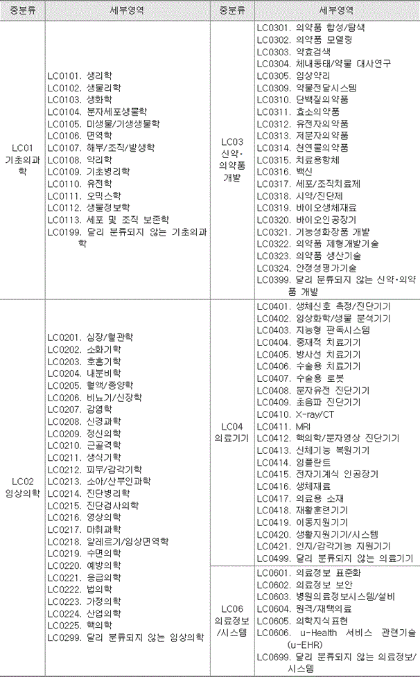

<details><summary>이미지 OCR 텍스트 (tesseract 자동인식 · 미검증 — 원문은 위 이미지)</summary>

```text
LCO301, 의약품 함성/탕색
LC0302, 의약품 모델링
LC0303, 약효검색
00304. 체내동태/약물 대사연구
60101. 생리학                        LC0305, 임상약리
60102. 생물리학                       00309. 약물전달시스템
00103. 생화학                        LCO310, 단백질의약품
LC0104, 분자세포생물학                  LCO311, BA) OS
LCO105, 미생물/기생생물학                LCO312, 유전자의약품
00106. 면역학                    | | 60919. 저분자의약품
0601 |ㄴ60107. 해부/조직/발생학            이아 (LCOSI4. 천연물의약품
기초의과 60108. 약리학                   의약품 |ㄴ00315. 치료용항체
학  |ㄴ00109. 기초병리학                개발 (UCOSTS. 백신
00110. 유전학                        LCO317. 세포/조직치료제
00111. 오믹스학                       60318. 시약/진단제
00112. 생물정보학                     Ｌㄴ00319. 바이오생체재료
00113. 세포 및 조직 보존학              L.C0320, 바이오인공장기
LC0199, 달리 분류되지 않는 기초의과        C0321, 기능성화장품 개발
학                                   LC0322, 의약품 제형개발기숲
LC0323, 의약품 생산기술
LC0324, 안정성평가기술
C0399, 달리 분류되지 않는 신약ㆍ의약
품 개발
60401. 생체신호 측정/진단기기
LCo402, 임상화학/생물 분석기기
LC0403, 지능형 판독시스템
LC0202. 소화기학                       60405. 방사선 치료기기
60203. 호흠기학                      LC0406. 수솔용 치료기기
C0204, 내분비학                       LC0407, 수술용 로봇
60205. 혈액/종양학                     ㄴ00408. 분자유전 진단기기
60206. 비뇨기/신장학                    LC0409, 초음파 진단기기
60207. 감영학                           LC0410, X-ray/CT
Lco208, 신경과학                   66004 |LCo411, MRI
Lco209. 정신의학              의료기기 |LC0412, 핵의학/분자영상 진단기기
C0210, 근꼴격학                        LC0413, 신체기능 복원기기
60212. 피부/강각기학                    ㄴ60415. 전자기계식 인공장기
ㄴ0602 |LC0213, 소아/산부인과학                 60416. 생체재료
60215. 진단검사의학                     LCO418, 재활훈련기기
60216. 영상의학                       LC0419, 이동지원기기
60217. 마취과학                       LC0420, 생활지원기기/시스템
60218. 알레르기/잉상면역학               LC0421, 인지/강각기능 지원기기
Se                     LC0499, 달리 분류되지 않는 의료기기
60220. 예방의학                        Ｌㄴ00601. 의료정보 표준화
60221. 충급의학                        LC0602, 의료정보 보안
60222. 없의학 '                     60603. 병원의료정보시스템/설비
LC0228. 기정의학                   00604. 원격/재택의료
LC0224, 산업의학                   16606 |ㄴ60604.
1200. wert                  의료정보 60605. 의학지식표현  oe
Lco299. 달리 분류되지 않는 임상의학 | /시스팀  0606. 00680  서비스 관련기울
ㄴ00699. 달리 문류되지 않는 의료정보/
시스템
```

</details>

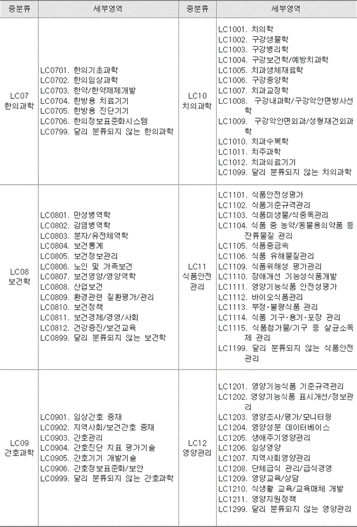

<details><summary>이미지 OCR 텍스트 (tesseract 자동인식 · 미검증 — 원문은 위 이미지)</summary>

```text
LC1001, 치의학
LC1002, 구강생물학
LC1003, 구강병리학
LC1004, 구강보건학/예방치과학
LCO701. 한의기초과학                      LC1005. 치과생체재료학
00702, 한의임상과학                     LC1006. 구강종양학
1607   60703. 한약/한약제제개발           16010  LC1007, 치과교정학
한의과학 00704. 한방용 치료기기        지의과학 LC1008, 구강내과학/구강악안면방사선
00705. 한방용 진단기기                           학
LC0706. 한의정보표준화시스템            LC1009, 구강악안면외과/성형재건외과
LCO799. 달리 분류되지 않는 한의과학              학
LC1010, 치과수복학
61011. 치주과학
LC1012. 치과의료기기
LC1099, 달리 분류되지 않는 치의과학
LC1101. 식품안전성평가
LC1102, 식품기준규격관리
00801. 만성병역학                      LC1103, 식품미생물/식중독관리
(60802. 감염병역학                       LC1104. 식품 중 농약/동물용의악풍 등
LC0803,. 분자/유전체역학                        URES 관리
LC0804, 보건롱계                       LC1105, 식품중금속
00805. 보건정보관리                   LC1106. 식품 유해물질관리
Loos  LCO806. 노인 및 가족보건           6611 |ㄴ61109, 식품위해성 평가관리
보건학  LC0807, 보건영양/영양역학         식품안전 |0ㄷ1110. 장애개선 기능성식품개발
00808. 산업보건                   관리 _|ㄴㄷ1111. 영양기능식품 안전성평가
(60809. 환경관련 질환평가/관리             LC1112, 바이오식품관리
(60810. 보건정책                       LC1113. 부정ㆍ물량식품 관리
00811. 보건경제/경영/사회                 LC1114. 식품 기구ㆍ용기ㆍ포장 관리
60812, 건강중진/보건교육                LC1115. 식품첨가물기구 등 살균소독
60899. 달리 문휴되지 않는 보건학                제 관리
LC1199. 달리 SRSA 않는 식품안전
관리
LC1201, 영양기능식품 기준규격관리
LC1202, 영양기능식품 표시개선/정보관
리
00901. 임상간호 중재                   LC1203, 영양조사/평가/모니터링
60902. 지역사회/보건간호 중재              LC1204. 영양성문 데이터베이스
1609   00903, 간호관리                   Lc12   LC1205, 생애주기영양관리
간후과학 60904. 간호진단 지표 평가기솔      영양관리  LC1206. 임상영양
(60905. 간호기기 개발기술             —™ |LC1207. 지역사회영양관리
00906. 간호정보표준화/보안               LC1208. 단체급식 관리/급식경영
(60999. 달리 분류되지 않는 간호과학         LC1209, 영양교육/상담
LC1210. 식생활 교육/교육매체 개발
LC1211, 영양지원정책
LC1299, 달리 분류되지 않는 영양관리
```

</details>

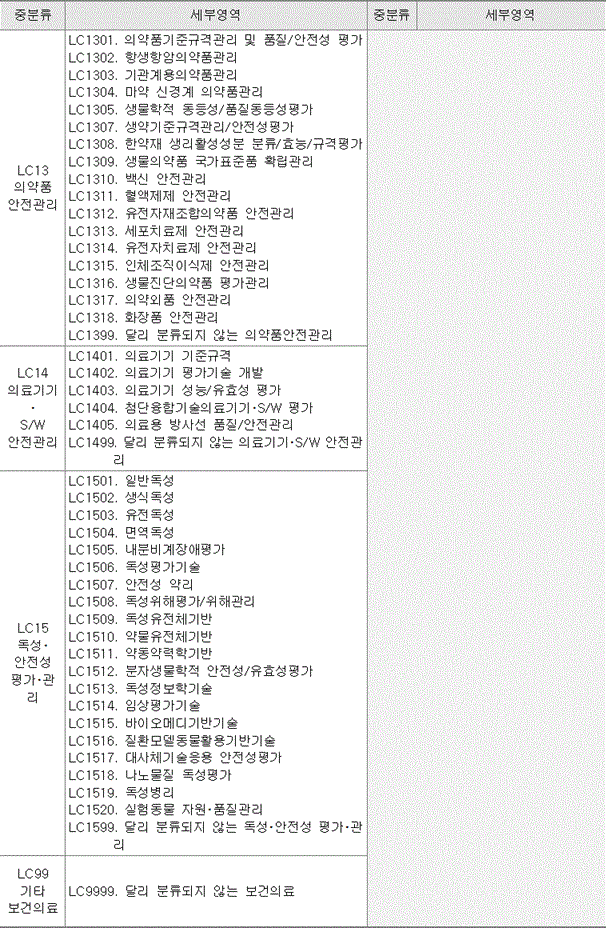

<details><summary>이미지 OCR 텍스트 (tesseract 자동인식 · 미검증 — 원문은 위 이미지)</summary>

```text
ㄴ61301. 의약품기준규격관리 및 품질/안전성 평가
LC1302, 항생항앙의약품관리
LC1303. 기관계용의약품관리
LC1304, 마약 신경계 의약품관리
LC1305, 생물학적 동등성/품질동등성평가
LC1307. 생약기준규격관리/안전성평가
LC1308. 한약재 생리활성성분 분류/효능/규격평가
114 |ㄴ61909, 생물의약품 BSS 확립관리
의약품  LC1310, 백신 안전관리
아전과기 |ㄴ01311. 혈액제제 안전관리
니니 두 7 |LC1312, 유전자재조합의약품 안전관리
LC1313. 세포치료제 안전관리
LC1314, 유전자치료제 안전관리
61315, 인체조적이식제 안전관리
61316. 생물진단의약품 평가관리
LC1317. 의약외품 안전관리
LC1318, 화장품 안전관리
LC1399, 달리 분류되지 않는 의약품안전관리
LC1401. 의료기기 기준규격
6614 |LC1402. 의료기기 평가기술 개발
의료기기 |LC1403, 의료기기 성동/유효성 병가
ㆍ  |ㄴ61404. 청단응합기술의료기기*5/\ 명가
SW |LC1405. ARS 방사선 품질/안전관리
안전관리 |ㄴ1499. 달리 SRSA 않는 의료기기*5/\ 안전관
리
ㄴ01501. 일반독성
ㄴ61502. 생식독성
61503. FASS
61504. 면역독성
ㄴ61505. 내분비계장애평가
61506. 독성평가기술
LC1507. 안전성 약리
LC1508, 독성위해명가/위해관리
| 61509. 독성유전체기반
독성. |ㄴ01510. 약물유전체기반
orig |ㄴ61511. 약동약력학기반
명 가.과 | 01512. 분자생물학적 안전성/유효성평가
리 “ |LC1513. 독성정보학기술
61514, 임상평가기술
LC1515. 바이오메디기반기술
61516. 질환모델동물활용기반기솔
61517. 대사체기술응용 안전성평가
LC1518. 나노물질 독성평가
LC1519. 독성병리
LC1520. 실험동물 자원*품질관리
LC1599, 달리 분류되지 않는 독성-안전성 평가-관
리
699
기타 |ㄴ9999. 달리 분류되지 않는 보건의료
보건의료
```

</details>

□ 인공물

EA. 기계

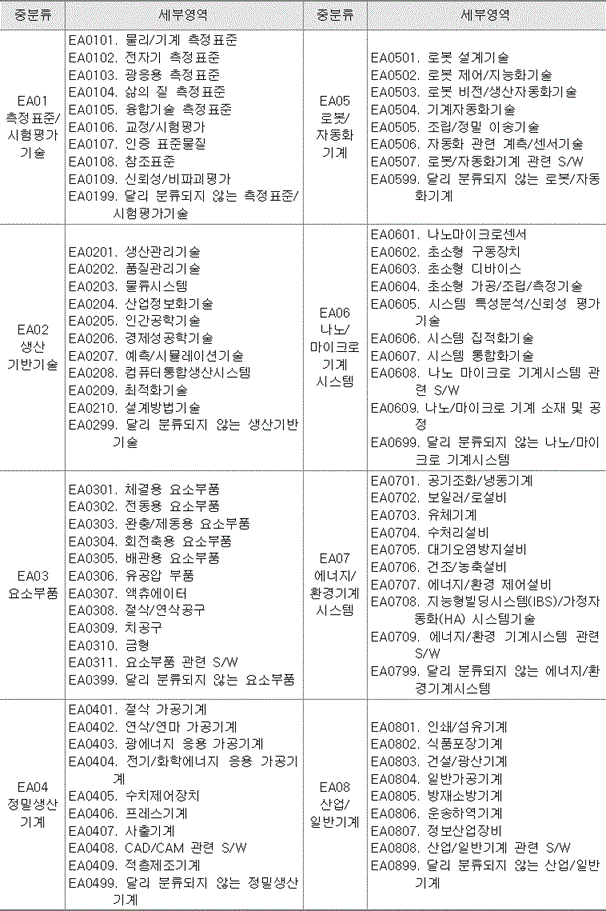

<details><summary>이미지 OCR 텍스트 (tesseract 자동인식 · 미검증 — 원문은 위 이미지)</summary>

```text
SEF            세부영역           세무영역
EA0101. 물리/기계 측정표준
EA0102, 전자기 측정표준                 EA0SO!, 로봇 설계기솔
60103. 광응용 측정표준                   EA0502, 로봇 제어/지능화기술
-. |640104. 삶의 질 측정표준           cas |£A0503. 로봇 비전/생산자동화기술
ax az EAS. 응합기술 측정표준          오보 ㅣ640504. 기계자동화기술
Alaa) |640106. 교정/시험평가            가즈. |660505. 조럽/정밀 이송기술
sia |640107. 인중 표준물질              기기 60506. 자동화 관련 계측/센서기술
EA0108, 참조표준                       60507. 로봇/자동화기계 관련 SAW
60109. 신뢰성/비파피평가                40599. 달리 분쥬되지 않는 로봇/자동
60199. 달리 분류되지 않는 측정표준/              화기계
시험평가기솔
EA0601, 나노마이크로센서
EA0201, 생산관리기술                   EA0602, FAM 구동장치
EA0202, 품질관리기술                   EA0603, 초소형 디바이스
60203. 물류시스템                     EA0604, 초소형 가공/조럽/측정기솔
EA0204, 산업정보화기술          cage |EA0805. 시스템 특성분석/신뢰성 평가
0 |640205, 인간공학기술              러버        기술
생사 |640206. 경제성공학기술          nholze |660606. 시스템 집적화기술
기반기술 EA0207. 예측/시뮬레이션기술         기기. |640607. 시스템 통합화기술
오기 를 £40208, 컴퓨터통합생산시스템       아히 |640608. 나노 마이크로 기계시스템 관
EA0209. 최적화기술                 =         련 s/w
EA0210, 설계방법기술                          EA06O9. 나노/마이크로 기계 소재 및 공
EA0299, 달리 분류되지 않는 생산기반            정
기술                          60699. 달리 분류되지 않는 나노/마이
크로 기계시스템
991 체결를 으수부품                 ㄷ40701. 공기조화/냉동기계
내                   60702. 보일러/로설비
EA0302. SSS 요소무품               EAO703. 유체기계
60303. 완충/제동용 요소부품                     me
a                 EA0704, 수처리설비
60304. 회전축용 요소부품                             :
소                   640705. 대기오영방지설비
EA0305. 배관용 요소부품            6407
EA0706, 건조/농축설비
64603 |640306. 유종압 TS            에너지 | AQ707, 에너지/환경 제어설비
분           즈                    a          ,
아버                            . 지능형빌덩시스템169)/가정자
EA0309. 치공구                                     =
지                      EAO709, 에너지/환경 기계시스템 관련
60311. 요소부품 관련 6/\
EAO799, 달리 분류되지 않는 에너지/환
°
EA0309, 달리 분류되지 않는 요소부품              aA
EA0401. 절삭 가공기계
EA0402, 연삭/연마 가공기계                ㄷ460801. 인쇄/섬유기계
EA0403, 광에너지 응용 가공기계             EA0802. 식품포장기계
EA0404, 전기/화학에너지 응용 가공기        60803, 건설/광산기계
계                              EA0804, 일반가공기계
정민 suas |640405. 수치제어장치              maga? |640805. 방재소방기계
기게. |640406. 프레스기계            일반기계 60606. 운송하역기계
ㄷ&0407. 사출기계                    오이겐 |e aggo7, 정보산업장비
EA0408. CAD/CAM 관현 S/W               EA08O8, 산업/일반기계 관련 5/\
60409. 적층제조기계                   EA0899, 달리 분쥬되지 않는 산업/일반
60499. 달리 분류되지 않는 정및생산            기계
기계
```

</details>

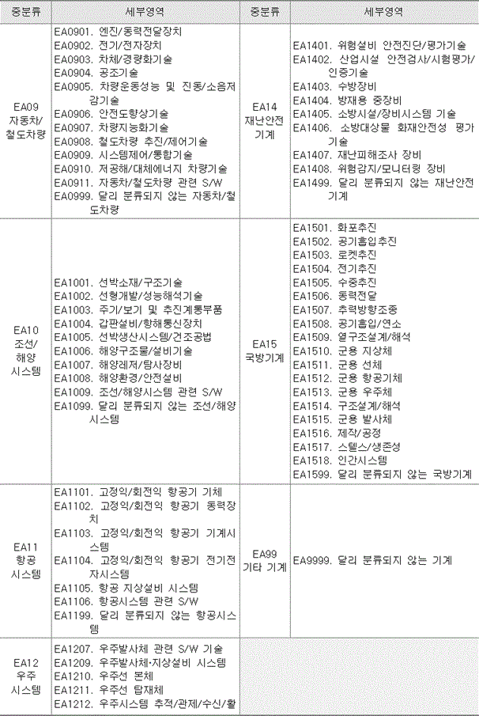

<details><summary>이미지 OCR 텍스트 (tesseract 자동인식 · 미검증 — 원문은 위 이미지)</summary>

```text
EA0901. 엔진/동력전달장치
EA0902. 전기/전자장치                    EA1401. 위험설비 안전진단/평가기솔
EA0903. 차체/경량화기술              EA1402. 산업시설 안전검사/시험평가/
ㄷ6&0904. 공조기술                            인중기술
ㄷ60905. AISSSAS 및 진동/소음저        EA1403. 수방장비
609       Wie                   14 |EA1404. 방재용 중장비
자동차/  ㄷ6ㄷ60906. 안전도향상기술           재나안전 EA1405, 소방시설/장비시스템 기술
철도차량 EA0907. 차랑지능화기솔         기계 EA1406. 소방대상물 화재안전성 평가
EA0908. 철도차량 추진/제어기술                   기출
EA0909. 시스템제어/통합기술                 EA1407. 재난피해조사 장비
6&0910. 저공해/대체에너지 차랑기술          EA1408, 위험감지/모니터렁 장비
ㄷ60911. 자동차/철도차량 관련 S/w          EA1499, 달리 분류되지 않는 재난안전
60999, 달리 분류되지 않는 자동차/철               기계
Sate
EA1501, 화포추진
EA1502, 공기흡입추진
EA1503, 로켓추진
EA1504, 전기추진
EA1001, 선박소재/구조기솔                 EA1505. 수중추진
EA1002. 선형개발/성능해석기술              EA1506. 동력전달
EA1003. 주기/보기 및 추진계롱부품          EA1507, 추력방향조종
010 |EA1004. 갑판설비/항해통신장치             EA1508, 공기흡입/연소
조선/  EA1005. 선박생산시스템/건조공법      EAIS  EA1509. 열구조설계/해석
해양   EA1006. 해양구조물/설비기솔        국방기계 EA1510. 군용 지상체
시스템  EA1007. 해양레져/탐사장비                 ㄷ61511, 군용 선체
으으 |EA1008. 해양환경/안전설비                 EA1512. 군용 항공기체
ㄷ61009. 조선/해양시스템 관현 S/W           EA1513. 군용 우주체
EA1099. 달리 SRSA] 않는 조선/해양         EAI514, 구조설계/해석
시스템                            EA1515. 군용 발사체
EA1516, 제작/공정
EAI5SI7, 스텔스/생존성
ㄷ&1518. 인간시스템
EA1599, 달리 문류되지 않는 국방기계
EA1101. 고정익/회전익 항공기 기체
61102. 고정익/회전익 항공기 SHA
치
EA1103. 고정익/회전익 항공기 기계시
EAI]        스템                     FAQS
HS (EA1104. 고정익/회전익 항공기 AIA 기타 기계 6ㄷ49999, 달리 SFRSIAl 않는 기계
시스템       자시스템
EA1105. 항공 지상설비 시스템
EA1106. 항공시스템 관현 5/\
ㄷ6&1199., 달리 분류되지 않는 항공시스
템
EA1207. 우주발사제 관련 S/W 기술
6612 61209. 우주밭사체지상설비 시스템
우주 61210, 우주선 본체
시스템 ：6&1211. 우주선 탑재체
61212. 우주시스템 추적/관제/수신/활
```

</details>

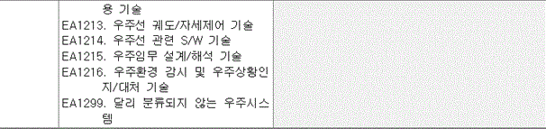

<details><summary>이미지 OCR 텍스트 (tesseract 자동인식 · 미검증 — 원문은 위 이미지)</summary>

```text
용 기술
EAI213. 우주선 궤도/자세제어 기술
6&1214, 우주선 관련 S/W 기술
61215. 우주임무 설계/해석 기울
EAI216. 우주환경 강시 및 우주상황인
지/대처 Jie
EA1299. 달리 문휴되지 않는 우주시스
템
```

</details>

EB. 재료

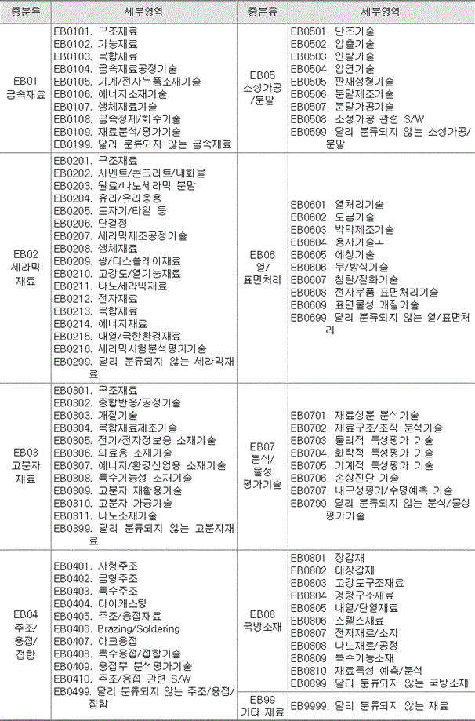

<details><summary>이미지 OCR 텍스트 (tesseract 자동인식 · 미검증 — 원문은 위 이미지)</summary>

```text
SEF            세부영역           MESS
EBO101. 구조재료                       EB0501. 단조기술
EB0102, 기능재료                       EB0502. 압출기술
660103. 복합재료                       660503. Ble
60104. 금속재료공정기술           Epos |£B0504. 압연기술
6601 (EBO105. 기계/전자부품소재기술    소성가공 |£B0505. 판재성형기술
ZAMS 660106. 에너지소재기술           “peg |680506. 분말제조기술
EBO107, 생체재료기술               TS |ㄷ60507. 분말가공기술
EB0108. 금속정제/회수기술                ㄷ60508. 소성가공 관련 s/w
ㄷ60109. 재료분석/평가기술                ㄷㅁ60599. 달리 분류되지 않는 소성가공/
EBO199. 달리 분류되지 않는 금속재료              분말
80201. 구조재료
660202., 시멘트/콘크리트/내화물
£80203, 원료/나노세라믹 분말
£80204. 유리/유리응용
660206. 던                               oi oe
EB0207, 세라믹제조공정기솔               드리 Slee
6602 |£80208. 생체재료                 66806 |6680605, 에칭기술
.     스플레이재료                      :
세라믹 다 0209. SISA           @/  |680606, 무/방식기술
£80210. 고강도/열기능재료            ‘
재료                         표면처리 |660607, 침탄/질화기술
60211. 나노세라믹재료                                    -
ecole, AAR                       EB0608. 전자부품 표면처리기술
660213. METS                     £60609. BUSS 개질기울      :
00214. LAX                     680000. 물리 SRSA 않는 열/표면처
60215. 내열/극한환경재료
EB0216, 세라믹시혐분석평가기송
660299, 달리 분류되지 않는 세라믹재
료
EB0301. 구조재료
£80302. 중합반응/공정기솔
£80303, 개질기솔                         660701. 재료성분 분석기솔
£80304, 복합재료제조기솔                660702. 재료구조/조직 분석기솔
EB0305, 전기/전자정보용 소재기솔     607 |£80703. 물리적 특성평가 기울
66803 (£80306. 의료용 소재기술           =a, |600704. 화학적 특성평가 기술
DEA |680307. 에너지/환경산업용 소재기술 | Sy |660705. 기계적 특성평가 기울
재료 |680308. 특수기능성 소재기술       명가기술 |£80706. 손상진단 기울
660309. 고분자 재활용기술                 EBO707, 내구성평가/수명예측 Ne
£80310. 고분자 가공기솔                  £80799. 달리 SRSA 않는 분석/물성
60311. 나노소재기술                          평가기솔
660399. 달리 문쥬되지 않는 고분자재
료
,    지
monn wane                          E0801. BO
660402. 금형주조                       EB0803, 고강도구조재료
EB0403. 특수주조                       660804. 경량구조재료
ㄷ6ㄷ60404. 다이캐스팅                      ㄷㅁ0805. 내열/단열재료
6604 660405. 주조/용접재료             6608  ㄷㅁ0806. 스텔스재료
용접/ (£80407. ba SS                      ㄷㅁ80808. 나노재료/공정
Be (€B0408. 욕수용접/접합기솔                ㄷㅁ80809, 특수기능소재
660409. SOF 문석평가기울              EB0810. MESA 예측/분석
EB0410. 주조/풍접 관현 S/W              EB0899. 달리 분류되지 않는 국방소재
680499, 달리 문류되지 않는 주조/용접/|-----
접합                     기아 89002. 달리 분류되지 않는 재료
```

</details>

EC. 화공

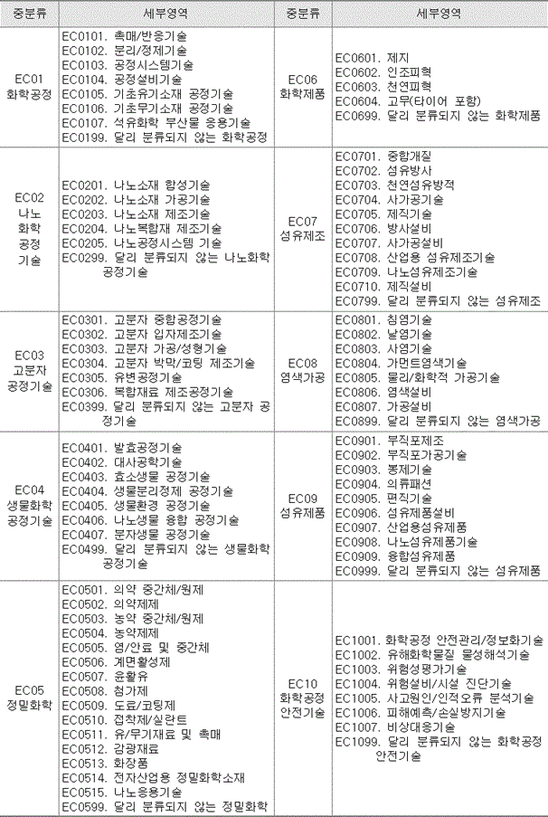

<details><summary>이미지 OCR 텍스트 (tesseract 자동인식 · 미검증 — 원문은 위 이미지)</summary>

```text
중분류            세부영역           세무영역
ㄷ00101. 촉매/반응기술
ㄷ600102. 분리/정제기술
6060103. 공정시스템기술                 다아 Clee
6001 |6ㄷ00104. 공정설비기술             ECO6 도이 Mamet
화학공정 60105. 기초유기소재 공정기술     화학제품 |=ㄴ0607 고루(단이어 포함)
ㄷ6ㄷ00106. 기초무기소재 공정기술             ㄷㅇ0699. 달리 분류되지 않는 화학제품
ㄷ6ㄷ00107. 석유화학 부산물 응용기술                 '     =      os
ECOI99. 달리 분류되지 않는 화학공정
ㄷ00701. 중함개질
ECO702. 섬유방사
ECO201, 나노소재 함성기술                00703, 천연성유방적
60602 6060202. 나노소재 가공기솔                 ㄷ6ㄷ00704. 사가공기술
나노 |600203. 나노소재 제조기술          2007 |ECO705. 제직기술
화학 |660204. 나노복함재 제조기솔       서우 제이 1660706, 방사설비
공정 |660205. 나노공정시스템 기술          소 |Ec0707. 사가공설비
기술 ,600299. 달리 분류되지 않는 나노화학        ECO708. 산업용 섬유제조기솔
공정기술                         00709. 나노섬유제조기술
ECO710. 제직설비
600799. 달리 분류되지 않는 섬유제조
20301. 고분자 Searle              00801. 침염기술
EC0302. 고분자 입자제조기솔               600802. 날염기술
003 |600303. 고분자 가공/성형기술              00803, 사염기술
seq |660904. 고분자 박막/코팅 제조기술 | 6008 |600804. 가먼트염색기술
우시 |EC0305. FH BAe            염색가공 |ECO805. 물리/화학적 가공기솔
SSS |ㄷ60306. 복합재료 제조공정기술             00806. 염색설비
EC0399. 달리 분류되지 않는 DEAS         600807. 가공설비
Ale                         EC0899, 달리 분류되지 않는 염색가공
. 부직포제조
cco. 봉기                 econ) EEE
EC0403, 효소생물 공정기술                60904. 의류패션
660 |600404. 생물분리정제 공정기술       6009 |6060905. 편직기술
Secret [600405. Sete 공정기울       ARM 00906. 섬유제품설비
SHAS 660406. 나노생물 SS 공정기술            600907. 산업용섬유제품
660407. EGS Se           ECO908, 나노섬유제품기술
공정기울                        ㄷ00999. 달리 분류되지 않는 섬유제품
ECO501. 의약 중간체/원제
ECO502. 의약제제
600503. 농약 중간체/원제
ECO504. 농약제제                                    이
Ecos eae                       EC1003, 위형성평가기술
Ecos        ai                  ECIO |EC1004. 위험설비/시설 진단기술
6<0608. 첨가저             화학공정 61005. 사고원인/인적오류 분석기솔
정밀화학 |[660509. 도료/코팅제           안전기술 01006. 피해예측/손실방지기술
아아 아아아 오오 이 오리             EC1007. 비상대응기술
ㄷ6ㄷ00511. 유/무기재료 및 =                 ：    ~.    아느
0                     601099, 달리 문쥬되지 않는 화학공정
EC0513. 화장품                             =e
EC0514. 전자산업용 정밀화학소재
ECO515. 나노응용기술
EC0599. 달리 분류되지 않는 정밀화학
```

</details>

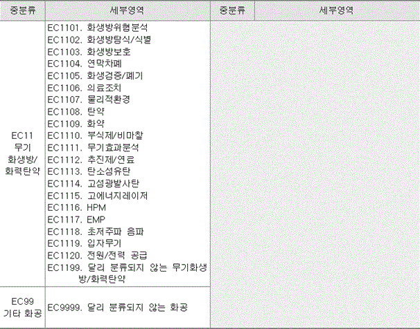

<details><summary>이미지 OCR 텍스트 (tesseract 자동인식 · 미검증 — 원문은 위 이미지)</summary>

```text
EC1101. 화생방위협분석
61102. 화생방탐식/식별
EC1103. 화생방보호
EC1104. 연막차페
EC1105. 화생겸중/페기
EC1106. 의료조치
EC1107. 물리적환경
61108. 탄약
EC1109. 화약
66011 _6061110. 무식제/비마찰
무기 _:6061111. 무기효과분석
화생방/ !ㄷ06111?2. 추진제/연료
화력탄약 ECII13. 탄소섬유탄
EC1114. 고섬광발사탄
EC1115. 고에녀지레이저
EC1116. HPM
EC1117. EMP
EC1118. 초저주파 음파
EC1119. 입자무기
EC1120. 전원/전력 공급
EC1199. 달리 SRSIAL 않는 무기화생
방/화력탄약
EC99                          아느
```

</details>

ED. 전기/전자

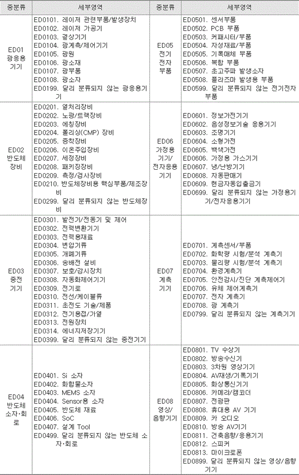

<details><summary>이미지 OCR 텍스트 (tesseract 자동인식 · 미검증 — 원문은 위 이미지)</summary>

```text
ㄷ6ㄷ00101. 레이저 관련무품/발생장치            ㄷ00501. 센서무품
ㄷ6ㄷ00102. 레이저 가공기                    6ㄷ00502. PCB 부품
ㄷ6ㄷ00103. 결상기기                         ED0503. 커패시터/무품
001   ㄷ60ㅁ0104. 광계측/제어기기            EDO05 |ㄷ00504. 자성재료/부품
222  EDO105S, 광원                    전기 _|ㄷ00505. 기폭매제 부품
기기   6ㄷ00106. 광소재                    전자 _|ㄷ00506. 목합 무품
ED0107. 광무품                   부품 _|ㄷ00507. 초고주파 발생소자
ㄷ6ㄷ00108. 광소자                         ㄷ00508. 플라즈마 발생용 부품
600199. 달리 문휴되지 않는 SSB        6ㄷ00599. 달리 문휴되지 않는 전기전자
기                                     부품
6ㄷ00201. 열처리장비
ㄷ6ㄷ00202. 노광/트랙장비                    600601. 정보가전기기
EDO203. 에칭장비                      ㄷ00602. 음성정보기술 응용기기
ED0204. 폴리싱(00) 장비                ㄷ00603. 조명기기
ㄷ6ㄷ00205. 중착장비                6006 |600604. ABO
ㄷ6002 ㄷ00206. 이온주입장비             가정용 |ㄷ00605. 백색가전
반도제 ：」ㄷ00207. 세정장비                  기기/ |ㄷ00606, 가정용 가스기기
장비 _:600208. 패키징장비            전자옹용 |600607. 냉/난방기기
6ㄷ00209. 측정/검사장비              기기 _|ㄷ00608. 자동판매기
6ㄷ00210. 반도체장비용 핵심부품/제조장          6ㄷ00609. 현금자동입출금기
비                          6ㄷ00699. 달리 문퓨되지 않는 가정용기
ED0299. 달리 문류되지 않는 반도체장            기/전자응용기기
비
ED0301. 발전기/전동기 및 제어
ED0302. 전력변환기기
ED0303. 전력용재료
ED0304. AA                        ㄷ6ㄷ00701. 계측센서/부품
ㄷ0ㅁ0305. 개페기류                        6ㄷ00702. StS 시험/문석 계측기
6ㄷ00306. 송배전 설비                    ED0703, BAS 시험/분석 계측기
6003 .ㄷ00307. 보후/감시장치            EDO? 600704. 환경계측기
중전 _ㄷ00308. 자동화제어기기             계측 _|600705. 안전강시/진단 계측제어기
기기 _:6ㄷ00309. 전기로                    기기 _|ㄷ00706. 유체 제어계측기
600310. 전선/케이불휴                     6ㄷ00707. 전자 계측기
ㄷ0ㅁ0311. 초전도 기출/제품                   ㄷ00708. 광 계측기
ㄷ6ㄷ00312. 전기용접/가열                   ㄷ00799. 날리 SRSA] 않는 계측기기
6ㄷ00313. 전원장치
ED0314. 에너지저장기기
6ㄷ00399. 달리 SRSA] 않는 중전기기
ED0801. TV 수상기
Epo0802. 방송수신기
ㄷ00803. 3차원 영상기기
6ㄷ00401. Si 소자                          6ㄷ00804. ^\재생/기쪽기기
ED0402. 화함물소자                       6ㄷ00805. Sat SBA I>]
0004   6ㄷ00403. MEMS 소자                       ㄷ00806. 카메라/캠코더
반도체  ED0404. Sensor# 소자             6008 |6ㄷ00807. 전광판
소자ㆍ회  ㄷ6ㄷ00405. 반도체 재료                Say ㅣ|ㄷ00808. 휴대용 AV 기기
=    ED0406. SoC                    음향기기 |EDO809. Ft 오디오
6ㄷ00407. 설계 Tool                           6ㄷ00810. BB 4\기기
ㄷ6ㄷ00499. 달리 문류되지 않는 반도체 소         6ㄷ00811. 건축음항/옹용기기
자ㆍ회로                         ㄷ00812. 스피커
ㄷ6ㄷ00813. 마이크로폰
6ㄷ00899. 달리 문류되지 않는 영상/음향
기기
```

</details>

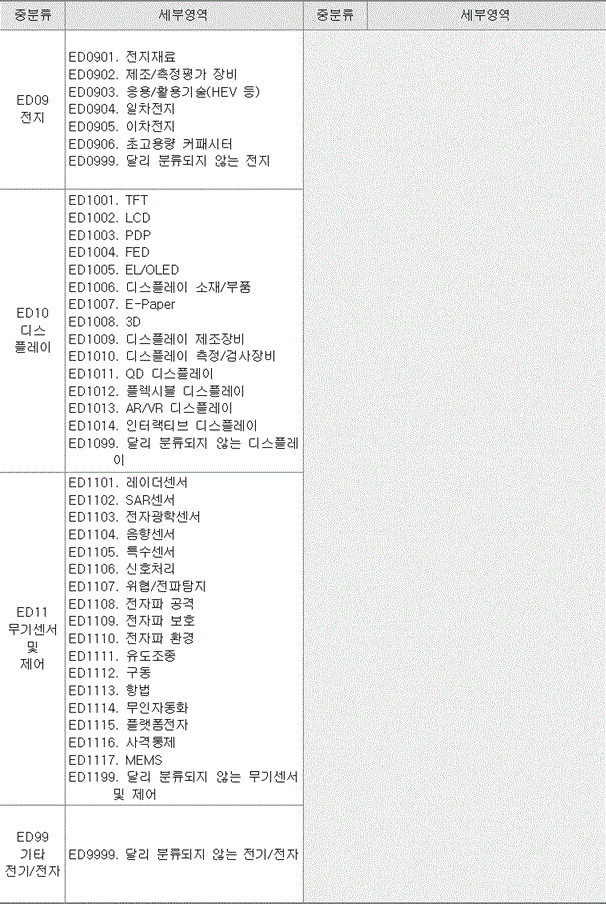

<details><summary>이미지 OCR 텍스트 (tesseract 자동인식 · 미검증 — 원문은 위 이미지)</summary>

```text
600901. 전지재료
600902. 제조/측정평가 장비
Epog |£00903. 응용/활용기술016 등)
ayy 1600904. 월차전지
SAI |ED0905. 이차전지
600906. 초고용량 커패시터
600999. 달리 분류되지 않는 전지
601001. TFT
601002. LCD
ED1003. PDP
ED1004. FED
ED1005. ELV/OLED
ED1006. 디스플레이 소재/무품
601007. E-Paper
마비 1601008. 30
플레이 」ㄷ1009. 디스플레이 제조장비
601010. 디스플레이 측정/검사장비
601011. 00 디스플레이
601012. 플렉시물 디스플레이
601013. AR/VR 디스플레이
601014. 인터랙티브 디스플레이
601099. 달리 문류되지 않는 디스플레
이
601101. 레이더센서
601102. SARMIA
ED1103. 전자광학센서
601104. 음향센서
601105. 특수센서
601106. 신호처리
601107. 위혐/전파탐지
cp1y (£D1108. 전자파 공격
-      ED1109. 전자파 보호
무기센서
이 1601110. 전자파 환경
oy EDI. 유도조종
601112. 구동
601113. 항법
601114. 무인자동화
601115. 플랫폼전자
601116. 사격통제
601117. MEMS
601199. 달리 분류되지 않는 무기센서
및 제어
6099
기타 |609999. 달리 분류되지 않는 전기/전자
전기/전자
```

</details>

EE. 정보/통신

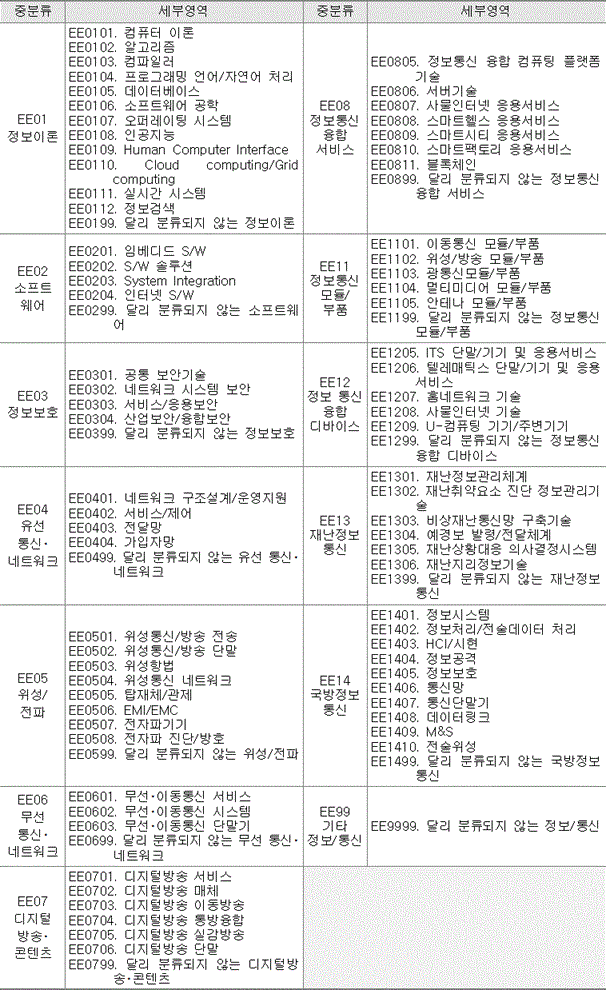

<details><summary>이미지 OCR 텍스트 (tesseract 자동인식 · 미검증 — 원문은 위 이미지)</summary>

```text
Bee aa er           세부영역
ㄷ660101, BAe 이론
EEO102.
660103. 컴파일러          :          660805. 정보통신 응합 컴퓨팅 플랫폼
ㄷ6ㄷ0104, 프로그래밍 언어/자연어 처리              기술
EEO105. 데이터베이스                    ㄷ6ㄷ0806. 서버기술
FEOI06. 소프트웨어 공학            ㄷ6ㄷ08 |ㄷㄷ0807. 사물인터넷 응용서비스
EEO!  :6ㄷ60107. 오퍼레이팅 시스템         정보통신 |6ㄷ60808. 스마트헬스 응용서비스
정보이론 660108. 인공지능                 융합 |ㄷ6ㄷ0809. 스마트시티 옹용서비스
£E0109, Human Computer Interface   서비스 |660810. 스마트팩토리 응웅서비스
EE0110. Cloud computing/Grid        ㄷㄷ0811. 블록체인       _
computing                    EEQ899. 달리 SRSIAl 않는 APSA
EEOI11. 실시간 시스템                            융합 서비스
ㄷㄷ60112, 정보검색
ㄷ6ㄷ0199. 달리 SRSA 않는 정보이론
신     부
E          1                        ㄷ6ㄷ1102. 위성/방송 모듈/부품
태02 [eens S       .           , |661103. 광롱신모듈/부품
. System Integration       AS SA
소프트        Shona                        EE1104. 멀티미디어 모듈/부품
이어 더 SEA SW oe ames) 모론 01105. 안테나 모듈/무품
660299. 달리 문류되지 않는 SESH) TS |=61199. 달리 분쥬되지 않는 정보통신
모듈/부품
EE1205. ITS 단말/기기 및 응용서비스
A 다        |
6603 |ㄷ0902. 네트워크 시스템 보안      정보 통신 |661207. 홈네트워크 Jie
정보보호 003. 서비스/응풍보안          Sf |6ㄷ1208, 사물인터넷 기술
660304. 산업보안/용함보안          디바이스 661209. 0-컴퓨팅 기기/주변기기
「       3 느                —        .      ㅠㅜ       ㅜ
융합 디바이스
ㄷ6ㄷ1301. 재난정보관리체계.
Aa
660401. 네트워크 구조설계/운영지원          때 702 MAS 거나 Ome
오이 [08 all               6613 |661303. 비상재난통신망 구축기술
"        ‘Si                    재난정보 |6ㄷ61304. 예경보 발령/전달체계
통신ㆍ .660404. 가입자망                  시          나사   2        A
네트워크      내로워크     노는 가연 종인         6ㄷ1306. 재난지리정보기술
=                         또리 SRSA 않는 재난정보
EE1401, 정보시스템       ㆍ
660501. ASSAYS 전송                 = 이분지이미 거기
6605 |660504. 위성통신 네트워크         EE14 |1406. 통신망
위성/ | EEO505, 탑재체/관제           국방 정보 | 717 SACO
Au} | EE0506. EMI/EMC                 SA ceiaos. 데이터링크
ㄷ6ㄷ0507, 전자파기기                       E1409. M&S
660508, 전자파 진단/방호                 61410. 전술위성
6606 ，660601. 무선ㆍ이동롱신 서비스
무선 |EE0602. 무선ㆍ이동통신 시스템        6699
시   ㄷㄷ0603. 무선ㆍ이동롱신 단말기        기타 _|ㄷㄷ9999. 달리 SRSA 않는 정보/통신
Si: !660699., 달리 분류되지 않는 무선 통신ㆍ|정보/통신
네트워크      네트워크
660701. 디지털방송 서비스
EEO702, 디지털방송 매체
EEO? (€€0703. 디지털방송 이동방송
디지털 60704. 디지털방송 Bese
Ye. |660705, 디지털방송 실강방송
콘텐츠 」660706. 디지털방송 단말
660799. 달리 분류되지 않는 디지털방
송ㆍ콘텐츠
```

</details>

EF. 에너지/자원

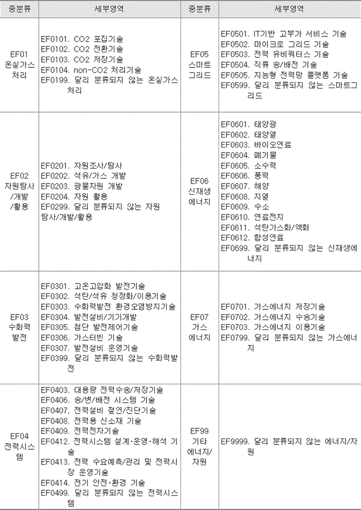

<details><summary>이미지 OCR 텍스트 (tesseract 자동인식 · 미검증 — 원문은 위 이미지)</summary>

```text
브          A
EFOIOI. CO2 포짐기승                     태0502. 마이크로 그리드 le
EFO102. 602 전환기솔                             ：            때
EFO1   EF0103, CO2 저장기술             EFOS ｜ㅣ타0503. 전력 유비쿼터스 기술
온실가스       '         =               스마트 (EFO504. AH 송/배전 기술
-      EFO1 04, non-CO2 Aerie               c             ae   저     == Sy   기술
저리  EFO199, 달리 분류되지 않는 온실가스  그리드 ㅣ태0505. 지능형 전력망 플랫폼
_    더     es   ~        타0599. 달리 SRSA 않는 스마트그
저리                                  리드
다0601. 태양광
EFO602. 태양열
타0603. bOI SAS
EFO604. 페기물
EFO201. 자원조사/탐사                    타0605. 소수력
EFO2 (€F0202. 석유/가스 개발            다006  EFO0606. 풍력
자원탐사 |탠0203, SSAA 개발            신재생  타0607. 해양
/개발 」타0204. 자원 활용               에너 지  타0608. 지열
/#2 (€F0299. 달리 분류되지 않는 자원           EFO609. 수소
탐사/개발/활용                          타0610. 연료전지
타0611. 석탄가스화/액화
EFO612. BAAS
EFO699. 날리 문류되지 않는 신재생에
녀지
타0301. DENYS} BAe
EFO302. 석탄/석유 청정화/이용기술
EFO303, 수화력발전 환경오염방지기술         타0701. 가스에너지 저장기솔
EFO3 」타0304. 발전설비/기기개밭         타07 (EFO702. 가스에너지 수송기술
수화력 ：」타0305, 첨단 발전제어기술           가스 |태0703. 가스에너지 이용기술
발전 (EFO306. 가스터빈 Je            에너지 |EFO799. 달리 SRSA 않는 가스에너
EFO307. 발전설비 운영기술                    지
EFO399. 달리 문류되지 않는 수화력발
전
EF0403. 대용량 전력수송/저장기솔
타0406. 총/변/배전 시스템 Jie
타0407, 전력설비 절연/진단기술
EFO408, 전력용 신소재 기술
EFO4  EFO409, ASAA le       ：       타 99
전력시스 타0412, 전력시스템 설계ㆍ운영ㆍ해석 기ㅣ 기타 |타9999. 달리 BRIA 않는 에너지/자
더 ey 때      솔                     에너지/       원
EFO413. 전력 수요예측/관리 및 전력시   자원
장 운영기술
EFO414, 전기 안전ㆍ환경 Jie
타0499. 달리 문휴되지 않는 전력시스
템
```

</details>

EG. 원자력

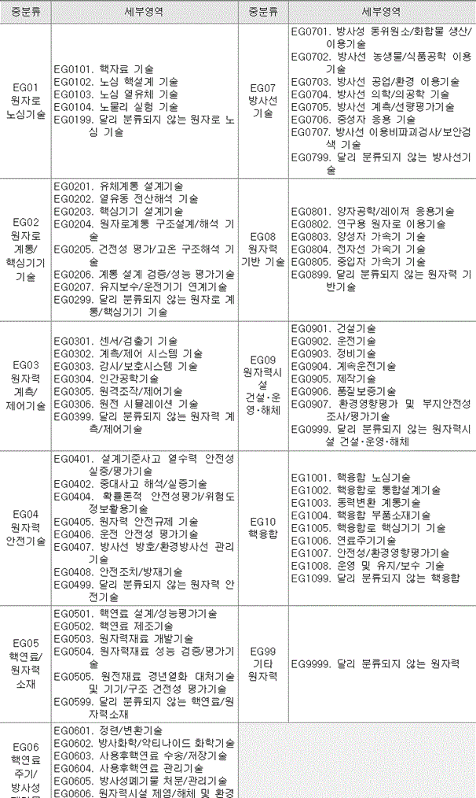

<details><summary>이미지 OCR 텍스트 (tesseract 자동인식 · 미검증 — 원문은 위 이미지)</summary>

```text
EGO701. 방사성 동위원소/화함물 생산/
이용기술
EGO702. 방사선 놓생물/식품공학 이용
ㄷ60101. 핵자료 기술                             기술
EGo1 」ㄷ90102. 노심 핵설계 기술          607  ㄷ060703. 방사선 공업/환경 이용기술
원자로  EGO1I03. 노심 열유체 기술          방사선  ㄷ060704. 방사선 의학/의공학 기술
ALD   EGO104. & Se} 실험 기술           We  EGO705. 방사선 계측/선량평가기술
노싱기울 egos. 달리 분류되지 않는 원자로 노         EG0706. 중성자 응용 기술
심 기술                           EGO707, 방사선 이용비파괴검사/보안검
색 기술
EGO799. 달리 SRSA 않는 방사선기
술
EG0201. 유체계통 설계기술
EG0202. SRS 전산해석 기술
EG0203. 핵심기기 설계기술                ㄷ60801. 양자공학/레이저 응용기술
6002 |ㄷ60204. 원자로계통 구조설계/해석 기        EG0802. 연구용 원자로 이용기술
원자로        e                       EGOS |EGOS03. 양성자 가속기 기술
계통/ |€G0205. 건전성 평가/고온 구조해석 기| 원자력 |ㄷ60804. 전자선 가속기 기술
핵심기기       2                     기반 기솔|660805. 중입자 가속기 기술
기술 (EG0206. AS 설계 검중/성등 평가기술         EGO899. 달리 문휴되지 않는 원자력 기
660207. 유지보수/운전기기 연계기술              ve
EG0299. 달리 분류되지 않는 원자로 계
통/핵심기기 기술
00901. 건설기술
660301. 센서/검출기 기울                 ㄷ60902. 운전기술
EG0302. 계측/제어 시스템 기술        606 |£60903. 정비기술
6003 |EG0303. 감시/보호시스템 기술      원자력 |690904. 계속운전기술
원자력 ㅣ660304. 인간공학기술               시 |EG0905. 제작기울
계측/ |660305. 원격조작/제어기술       agg 90906. BWYSIe
MOD] & |EGO3O6. HA 시뮬레이션 Iie      영ㆍ해체 EGO907. 환경영향평가 및 부지안전성
660399. 달리 분류되지 않는 원자력 계               EAVES
측/제어기술                     6060999. 달리 분쥬되지 않는 원자력시
설 건설ㆍ운영ㆍ해체
ㄷ60401. 설계기준사고 열수력 안전성
실증/평가기술                                  시
00402. 6대사고 해기/외잔기운             61002. Meee SBS Ae
6004        정보활응기술                     EG1004. HSB 부품소재기술
원자력 |EG0405. 원자력 안전규제 기술        EGIO 61005. HSB] 핵심기기 기술
om ㅇ                             .
or ogg 1660406. 운전 안전성 평가기술      mse 도이 이아 아오 오고 기을
wo  |660407. BAKE 방호/환경방사선 관리       661007. 안전성/환경영향평가기술
EGI008. 운영 및 유지/보수 기술
ㄷ60408. 안전조치/방재기술                       달기 부     았는
60499. 달리 분류되지 않는 원자력 ot        ㄷ061099. 달리 분류되지 않는 핵융합
전기솔
6060501. 핵연료 설계/성능평가기술
EG0502, 핵연료 MANE
606 |EG0503. 원자력재료 개발기술
책연료/ |ㄷ90504. 원자력재료 성능 겸중/평가기| 6099
Pyar       2                      기타 |609999. 달리 분류되지 않는 원자력
say (£90808. 원전재료 경년열화 ae) 원자력
=          및 기기/구조 건전성 Bople
EGO599. 날리 분류되지 않는 핵연료/원
자력소재
600601. 정련/변환기술
2606 ，600602. 방사화학/악티나이드 화학기술
sire |690603. 사용후핵연료 수송/저장기술
주기 |EG0604. 사용후핵연료 관리기솔
방사성 (E0005. 방사성폐기물 처분/관리기술
SAS lcaosog. 워자력시설 제연/해제 및 ates
```

</details>

EH. 환경

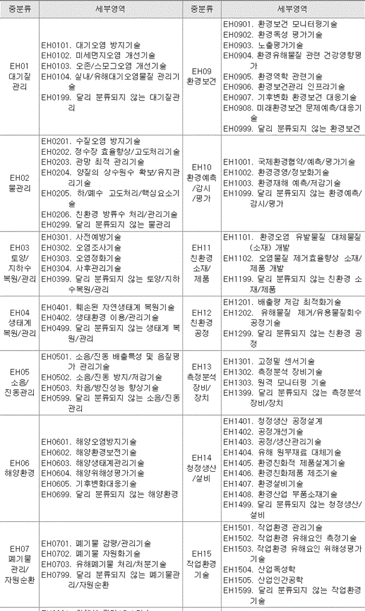

<details><summary>이미지 OCR 텍스트 (tesseract 자동인식 · 미검증 — 원문은 위 이미지)</summary>

```text
타10901. 환경보건 모니터렁기술
태0902. 환경독성 평가기술
타10101. 대기오염 방지기술                태10903. 노출평가기술
타10102. 미세먼지오염 개선기술              EHO904. 환경유해물질 관련 건강영향평
EHO] 」타0103. 오존/스모그오염 개선기솔     다       가
대기질 」ㅣ타0104. 실내/유해대기오영물질 관리기 | given, |타0905. HIM BAIS
관리        술                             EHO906, 환경보건관리 인프라기술
타10199. 달리 분쥬되지 않는 대기질관         태10907. 기후변화 환경보건 대응기술
리                                태10908. 미래환경보건 문제예측/대옹기
술
태10999. 달리 분류되지 않는 환경보건
타10201. 수질오염 방지기술
타10202. 정수장 AS DSH ie
타10203. 관망 최적 관리기술          cn1g 」태1001. 콕제환경협약/예측/평가기술
cHoo |EHO204. SS] 상수원수 SAAB) ye 타1002. 환경경영/정보화기술
asa        ale                     aay |EH1003. 환경재해 예측/저감기솔
우이 |타0205. Sil 고도처리/핵심요소기| "알기 |타1099. 달리 분쥬되지 않는 환경예측/
술                                  강시/형가
타10206. 친환경 방류수 처리/관리기술
타10299. 달리 분쥬되지 않는 물관리
EHO301. 사전예방기솔               태1101. 환경오염 유발물질 대체물질
EHO3 」타10302. 오염조사기술              태11        (소재) 개발
토양/ 」타10303. 오염정화기술           친환경 ㅣ태1102. 오염물질 제거효율향상 소재/
지하수 」타0304. 사후관리기술               소재/        제품 개발
목원/관리 EHO399. 달리 SRSA 않는 토양/지하ㅣ 제품 _ ㅣ타11199. 달리 분류되지 않는 친환경 ar
수복원/관리                           재/제품
이이                         타11201. 배출량 AZ 최적화기술
터04 /EHOAOT. 버거 시   EH12 」태1202. 유해물질 제거/유홍물질회수
A           a           [매리
Seta |EHosgo, 달리 분류되지 않는 생태계 =| CES      공정기울
목원/관리      원 /관리       =      | 공정  |태1299. 달리 문류되지 않는 친환경 공
더                                정
타10501. 소음/진동 less 및 음질평                     시
타105        가 관리기을                ERIS  = tiia0e anaes suse
ea [EHOS02. 소흥/진동 방지/저강기술 | 측정문석 | 이구 oucal 기술
ate          , =} 으/바지                  비/        "
진둥과기 |타10503. 차음/방진성능 향상기술      BWV |eni309, 달리 분튜되지 않는 측정분석
타10599. 달리 분류되지 않는 소음/진동| 장치        자비/장위
관리
EH1401. 청정생산 공정설계
태11402. 공정개선기술
타10601. 해양오염방지기술                 태11403. 공정/생산관리기솔
타10602. 해양환경보전기숲           14 ㅣ|태1404. 유해 원부재료 대체기술
태106 」태0603. 해양생태계관리기솔       azn .타1405. 환경친화적 제품설계기술
해양환경 |타10604. 해양위해성평가기술        정이 타1406. 환경친화제품 제조기술
타10605. 기후변화대응기술                  타11407. 환경설비기술
타10699. 달리 분쥬되지 않는 해양환경        태11408. 환경산업 부품소재기술
타11499. 달리 문류되지 않는 청정생산/
설비
타11501. 작업환경 Bee
태11502. 작업환경 유해요인 S818
EHO701. 폐기물 강량/관리기술                              0] 215
ae  EHO702. 폐기물 자원화기술           EHI5  ee mates tes!
타10703. RABIES 처리/처분기솔  ｜작업환경
Sev EHO799. 달리 분류되지 않는 폐기물관| 기술 | 이 VeSSe
자원순환       리 /자원순환    ws      =         EH1505. 산업인간공학
=                     타11599. 달리 분류되지 않는 작업황경
기술
```

</details>

EI. 건설/교통

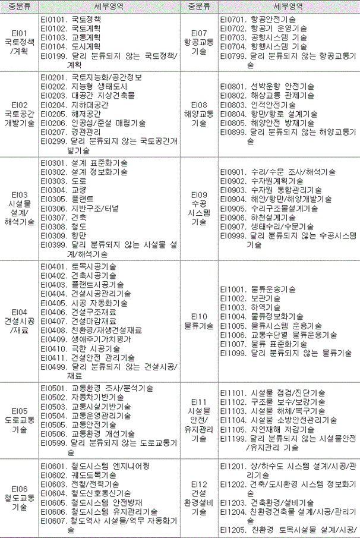

<details><summary>이미지 OCR 텍스트 (tesseract 자동인식 · 미검증 — 원문은 위 이미지)</summary>

```text
중분류            MESS           세부영역
：                                  디0701., BSA |e
라서 Bry                     터0702. 항공기 운영기술
틴01  !더0103. 교통계획                 El? [더0703. 공항시스템 기술
SESS cioi0d. 도시계획                하흑피호 티0704. 항행시스템 기술
‘AB | 다0199. 달리 분류되지 않는 국토정책/        티0799. f 분류되지 않는 항공교통기
계획
£10201, 국토지능화/공간정보
티0202, 지능형 생태도시                   티0801. 선박운항 안전기술
£10203, 대공간 Age ae            ne   £10802, Hans 관제기술
Elo2 」터0204, 지하대                     . 인적안전
국토공간 !터0205. 해저공간                 해양교통 '디0804. 항만/항로 설계기술
개발기술 터0206. 인공섬/준설 Ble         기술 |티0805. 해양안전 방재기울 .
티0207. 경관관리                          El0899. 달리 SHIA 않는 해앙교통기
티0299, 달리 분류되지 않는 국토공간개               e
le
티0301. 설계 표준화기술                                      ：
£10302, 설계 정보화기술                  £10901, 수리/수문 SAHA
E10303.                                   . 주     회
터0304. 교량                        터0903. 수자원 통함관리기솔
턴03 | E10305. 플랜트              티09 | Elo904. 해안/항만/해양개발기술
MS 른 |디0306. 지반구조/터널              시이 ㅣ60905. 수리구조물설계기술
2 W  \ci0307, 건축                      ve 10906. 하천설계기술
해석 기은 |다308. 철도                           티0907. 생태수리/수문기술
티0309. 항만                             티0999. 달리 분류되지 않는 수공시스템
티0399, Se] SRSA 않는 시설물 설             기술
계/해석기술
티0401. 토목시공기술
60402. 건축시 3718 .
터0403. 플랜트시공                           exes)
터0404. 건설시공관리기숲                  Soom eee le
터0405. 시공 자동화기술                        티 1002, 보라기호
다나 loca Shuma              티10 |티1004. 물류정보화기솔
ea” [티며07, 건앨마러재도            She |티1005. 물류시스템 운용기술
"재로 [티마 AES             티1006, 교롱수단별 SHERI
티0409, eee                  E1007. 물류 표준화기술
E10410, 극한 시공                         |    분   지 않는 물류기술
틴0411. 건설안전 관리기술             티1099. Se] SRSA 않는 =
터0499. 달리 문휴되지 않는 건설시공/
재료
티0501. 교통환경 조사/문석기울            101. 시설물   /진단기술
티0502. 자동차기반기울             티11   러 스노 나뱃다외혀
E105 」디0503. 교흉시설기반기울           시설물 |티1103. 시설물 해체/복구기술
cane 디0904. 교륭운영관리기을           안전/ 」티1104. 시설물 소방안전관리기송
기솜 |£10505. 교륭안전기울          유지관리 |EN105, 자연재해 저감기술
티0506. MSHS 개선기술            기술 |티1199. 말리 분류되지 않는 시설물안전
10599. 달리 분류되지 않는 도로교통기             dao te
&
티0601. # SAI 스템 엔지니어령                 61201. 상/하수도 시스템 설계/시공/관
티0602, 궤도토목ㄱ
ciog |610609. 전철/전력기술                터12_」티1202, 건축/도시환경 시스템 정보화기
철도교통 터0604. 철도신후통신기술           건설       =
Fe (E1005. 철도시스템 안전방재        환경설비 |티1203. 건축환경/설비기술
터0606. SETS Bowe esi)    기술    티1204, 지환경건족들 설계/시공/관리기
티0607. 철도역사 시설물/역무
시       호            티1205. 친환경 토목시설물 설계/시공/
```

</details>

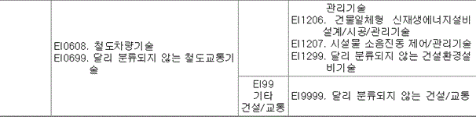

<details><summary>이미지 OCR 텍스트 (tesseract 자동인식 · 미검증 — 원문은 위 이미지)</summary>

```text
관리기솔
티1206. 건물일체형 신재생에너지설비
설계/시공/관리기술
딘0608. 철도차량기술                          E1207. 시설물 소음진동 제어/관리기술
El0699. 달리 문휴되지 않는 철도교통기          티1299. 달리 분류되지 않는 건설환경설
술                                      dle
EI99
기타 | EI9999,. 달리 SRSA 않는 건설/교통
건설/교통
```

</details>

□ 인문사회학

HF. 인문학

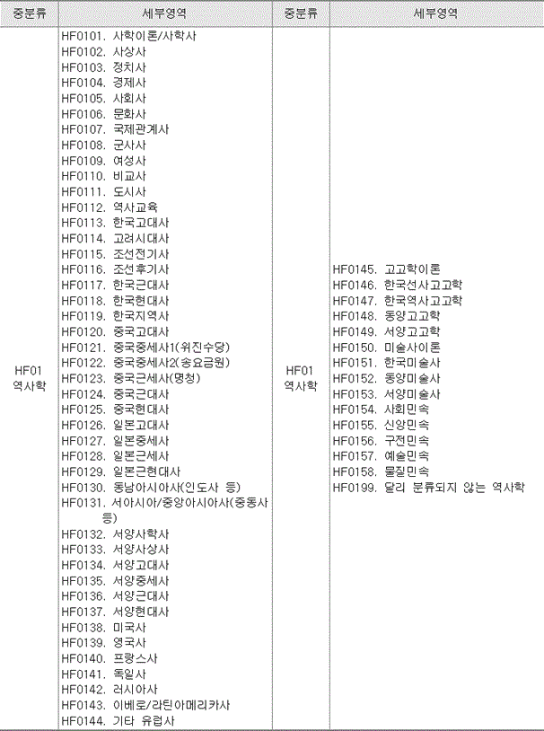

<details><summary>이미지 OCR 텍스트 (tesseract 자동인식 · 미검증 — 원문은 위 이미지)</summary>

```text
HFO101. 사학이론/사학사
바0102, 사상사
HFO103. 정치사
HFO104. 경제사
HFO105. 사회사
HFO106. 문화사
바0107. 국제관계사
HFO108. 군사사
HFO109. 여성사
HFO110. 비교사
HFO111. SAIAt
HFO112. 역사교육
HFO113. 한국고대사
HFO114. 고려시대사
HFO115. 조선전기사
HFO116. 조선후기사                   HFO145. 고고학이론
HFO117. 한국근대사                     HFO146, 한국선사고고학
바0118. 한국현대사                     HFO147, 한국역사고고학
바0119. 한국지역사                    바0148, 동양고고학
HFO120. 중국고대사                    HFO149, 서양고고학
HFO121. 중국중세사1(위진수당)            HFO150, 미술사이론
HFOI   바0122. 중국중세사2(송요금원)       001   바0151, 한국미술사
역사학  HFO123. 중국근세사(명청)         역사학  바00152. SFO] est
바0124. 중국근대사                    HFO153, 서양미술사
HFO125, 중국현대사                    HFO154, 사회민속
바0126. 일몬고대사                    바60155. 신앙민속
바0127. 일본중세사                   HFO156, 구전민속
HFO128, 일본근세사                    바0157. 예솔민속
바00129. 일몬근현대사                  바00158, 물질민속
HFO130. 동남아시아사(인도사 등)            HFO199, 달리 분류되지 않는 역사학
HFO131. 서아시아/중앙아시아사(중동사
S)
HFO132. 서양사학사
HFO133. 서양사상사
HFO134. 서양고대사
바0135. 서양중세사
HFO136. 서양근대사
HFO137. 서양현대사
바0138. 미국사
HFO139. 영국사
HFO140. 프랑스사
바0141, 독일사
HFO142, 러시아사
HFO143. 이베로/라틴아메리카사
HFO144. 기타 유럽사
```

</details>

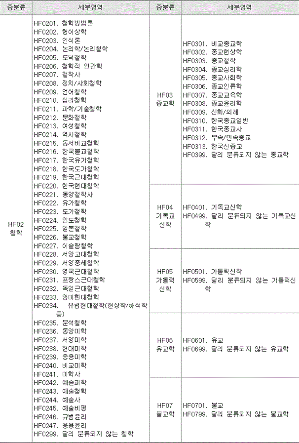

<details><summary>이미지 OCR 텍스트 (tesseract 자동인식 · 미검증 — 원문은 위 이미지)</summary>

```text
al          세부영역
HF0201. 철학방법론
HF0202, 형이상학
HF0203. 인식론                      HFO301. 비교종교학
HF0204, 논리학/논리철학                HFO302, 종교현상학
바0205. 도덕철학                    HF0303. 종교철학
HFO206. 철학적 인간학                 HF0304, 종교심리학
HF0207. 철학사                       바0305. 종교사회학
HF0208, 정치/사회철학                  HFO0306, Bie! Fe
HF0209. 언어철학               HFO3 |HF0307, 종교교육학
HF0210. 심리철학              종교학 |HF0308. 종교윤리학
HFO211. 과학/기술철학                   HFO309, 신화/의례
HF0212. 문화철학                     HFO310, 한국종교일반
HF0213. 여성철학                      HFO311. 한국종교사
HFO214, 역사철학                     HFO312. 무속/민속종교
바0215. 동서비교철학                  바0313. 한국신좋교
바0216. 한국물교철학                   HFO399, 달리 문류되지 않는 종교학
HFO217. 한국유가철학
HFO218. 한국도가철학
HFO219, 한국근대철학
HFO220. 한국현대철학
HF0221. 동양철학사
HF0222. 유가철학               HFO4 |HFO401, 기독교신학
HFO223, 도가철학              기독교 |1『0499. 달리 분류되지 않는 ISDA
502 |HFO224. 인도철학                신학       학
철학   HF0225. 일본철학
HF0226, 불교철학
HF0227. 이슬람철학
바0228. 서양고대철학
HFO229, 서앙중세철학
HF0230, 영국근대철학             HFO5 |HFO501. 가톨럭신학
HF0231, 프랑스근대철학          가톨릭 |HFOS99. 달리 SRSA 않는 BSAA!
HF0232. 독일근대철학             신학       학
HF0233. 영미현대철학
HF0234. 유럽현대철학(현상학/해석학
S)
HF0235. 분석철학
HF0236. 동양미학
HFO237, 서양미학               바06 |바0601. 유교
나0238. 현대미학                유교학 | 0699. 달리 문류되지 않는 유교학
HF0239. 응용미학
HF0240. 비교미학
바0241. 미학사
HF0242. 예술과학
HF0243. 예술철학
NFO, 예옹비명                바07 10701. 불교 00000
60246. 규범윤리               불교학 |HF0799. 달리 SRSA 않는 불교학
HF0247, 응용윤리
HF0299, 달리 분휴되지 않는 철학
```

</details>

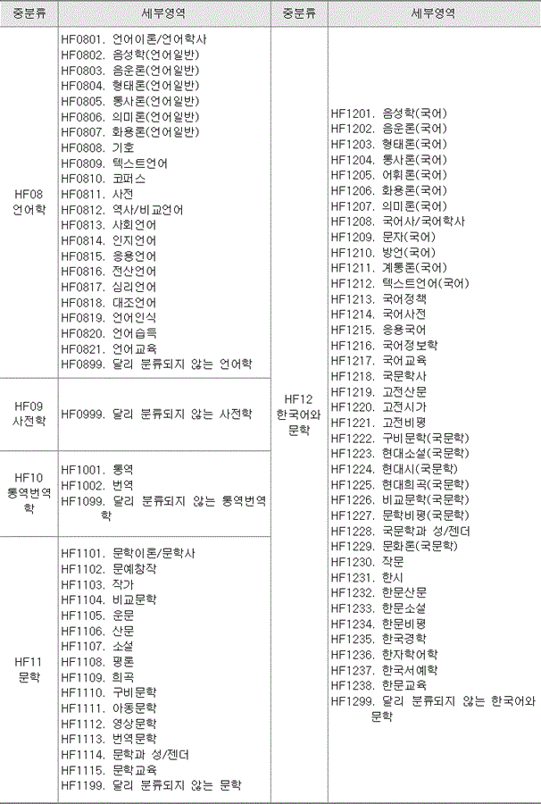

<details><summary>이미지 OCR 텍스트 (tesseract 자동인식 · 미검증 — 원문은 위 이미지)</summary>

```text
바0801. 언어이론/언어학사
HFO802, 음성학(언어일반)
바0803. 음운론(언어일반)
바0804. 형태론(언어일반)
HFO805. 통사존(언어일반)
HFO806. 의미론(언어일반)                HF1201. 음성학(국어)
바0807. 화용론(언어일반)                HF1202. 음운론(국어)
HFO808. 기호                          HF1203. 형태존(국어)
HFO809, 텍스트언어                   HF1204. 통사론(국어)
HFO810. 코퍼스                      HF1205. 어휘론(국어)
HFO8 60811. 사전                         1206. 화용론(국어)
언어학 |HFOS12. 역사/비교언어                  \『ㄷ1207, 의미론(국어)
HFO813. 사회언어                     바1208, 국어사/국어학사
HFO814, 인지언어                     바1209. 문자(국어)
바00815. 응용언어                     HF1210, 방언(국어)
HFO816, 전산언어                       HF1211, 계통론(국어)
HFO817. 심리언어                      HF1212, 텍스트언어(국어)
HFO818, 대조언어                     HF1213, 국어정책
HFO819, 언어인식                     HF1214. 국어사전
HF0820. 언어습득                     HF1215. 응용국어
HF0821. 언어교육                     HF1216, 국어정보학
HFO899, 달리 문류되지 않는 언어학         HF1217, 국어교육
HF1218, 국문학사
배12 1219. Dade
HFO9              =      아느                 HF1220, 고절시가
사전학  HFOSS9, 달리 분류되지 않는 사전학   Bao HF1291. 고정비평
=    HF 1222, 구비문학(국문학)
HF1223. 현대소설(국문학)
10 |HFI001. 통역                       HF1224, 현대시(국문학)
통역번역 바1002. 번역                       1225, 현대희곡(국문학)
학 HF1099. 달리 문류되지 않는 SAWS       HF1226, 비교문학(국문학)
학                         HF1227, 문학비평(국문학)
HF1228, 국문학과 성/젠더
바1101. 문학이론/문학사                 ee oo
HF1102. 문예창작                          그노
HF1103, 작가                         바1231, 한시
HF1104, 비교문학                      HF1232, 한문산문
HF1105. 운문                         HF1233. 한문소설
HF1106, 산문                     HF1234, 한문비평
HF1107, 소설                        HF1235, 한국경학
바11 |HF1108, 평론                 HF 1236, 한자학어학
문학 1109. 희곡                        HF1237, 한국서예학
~    HF1110. 구비문학                     HF1238, 한문교육
1111. 아동문학                    11299. 달리 분류되지 않는 한국어와
HF1112, 영상문학                          문학
HF1113. 번역문학
바1114. 문학과 성/젠더
HF1115. 문학교육
HF1199. 달리 문휴되지 않는 문학
```

</details>

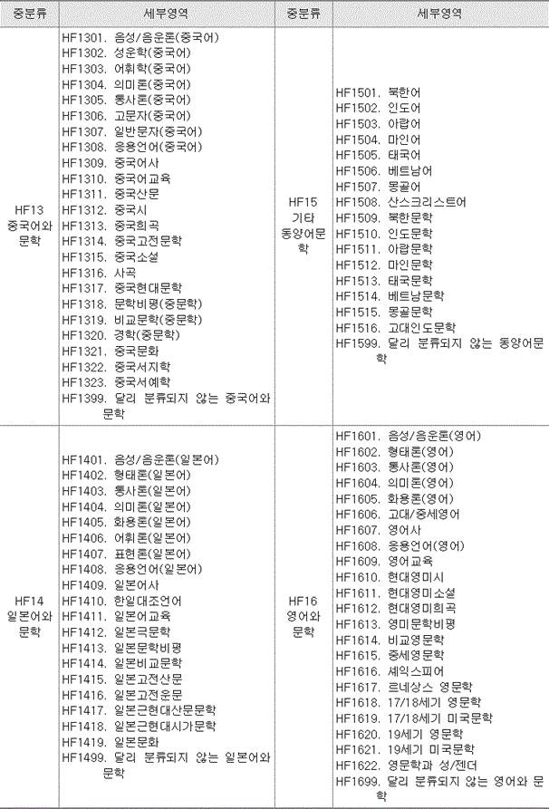

<details><summary>이미지 OCR 텍스트 (tesseract 자동인식 · 미검증 — 원문은 위 이미지)</summary>

```text
SF          세부영역
HF1301. 음성/음운존(중국어)
HF 1302. 성운학(중국어)
바1303. 어휘학(중국어)
1304. 의미존(중국어)                            1!
HF1305. SAH=(S 30)                 비디: veel
HF1306, 고문자(중국어)                 HF 1503. 아랍어
HF1308. 응용언어(중국어)                HF1505, 태국어
HF1309. 중국어사                     1506. 베트남어
바1310. SS as                   HF1507, 2204
_  eet aay               HF15 |HF1508, 산스크리스트어
.                                  무한
중국어와 |HF1313. 중국희곡             등양어론 licic, 인도문학
문학 |HFI314. 중국고전문학             학 1511. 아랍문학
바1315, Saxe                     HF 1512, 마인문학
HF1316, 사곡                                  무한
1317. 중국현대문학                  Hrisia, 베크날문학
HF1320. 경학(중문학)                  HF1599, 달리 분류되지 않는 동양어문
HF1321, 중국문화                         학
HF1322. 중국서지학
HF1323. 중국서예학
1399. 달리 분휴되지 않는 중국어와
문학
HF1601. 음성/음운론(영어)
HFI401. 음성/음운론(일본어)              Melee. searecaton
HF1402. 형태존(일본어)                  HF 1604, 의미론(영어)
HF1403. 통사론(일본어)                  HF1605, 화용론(영어)
바1404. 의미콘(일본어)                 HF 1606, 고대/중세영어
HF1405. 화용존(일본어)                  HF1607, 영어사
바1406. 어휘론(일본어)                 HF1608, 응용언어(영어)
바1407. 표현존(일본어)                 HF1609, 영어교육
HF1408, 응용언어(일본어)                HF1610. 현대영미시
바1409. 일본어사                      HF1611, 현대영미소설
바14 |HF1410, 한일대조언어             나 10 |61612, 현대영미희꼭
일몬어와 |『1411. 일몬어교육              St cies, 영미문학비평
문학 HFI412, 일본극문학              SS lurie4. 비교영문학
HF1413, 일몬문학비평                  바1615. SAIS Set
HF1414, 일몬비교문학                   1616, 셰익스피어
바1415. EDIE                  바1617, 르네상스 영문학
바1416. 일본고전운문               HF 1618, 17/18세기 영문학
Hea. eee.              바1619. 17/18세기 O| RSet
isis. gee              나 1601. 10세기 미국문학
HF1499. 달리 문류되지 않는 일본어와        \『ㄷ1622, 영문학과 성/젠더
문학                             1699. 달리 분쥬되지 않는 영어와 문
학
```

</details>

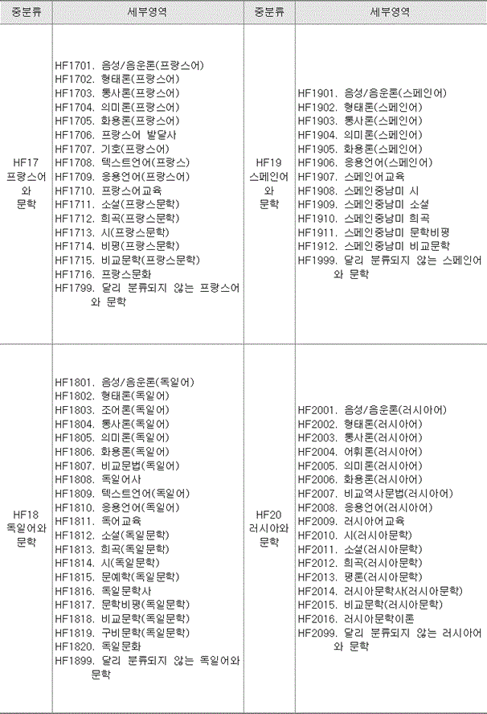

<details><summary>이미지 OCR 텍스트 (tesseract 자동인식 · 미검증 — 원문은 위 이미지)</summary>

```text
HF1701. 음성/음운존(프랑스어)
HF1702. 형태론(프랑스어)
바1703. 통사론(프랑스어)                HF1901. 음성/음운론(스페인어)
HF1704, 의미존(프랑스어)                 HF1902, 형태존(스페인어)
HF1705. 화용론(프랑스어)                HF1903. 통사론(스페인어)
HF1706, 프랑스어 발달사                 바1904. 의미론(스페인어)
바1707. 기호(프랑스어)                   바1905. 화용존(스페인어)
HF17 |HF1708. 텍스트언어(프랑스)        HF19 11906. 응용언어(스페인어)
프랑스어 |HF1709. 응용언어(프랑스어)       스페인어 |HF1907, 스페인어교육
와 _ 」|바1710. 프랑스어교육             와 = | HF 1908, 스페인중남미 시
문학 _ 바1711. 소설(프랑스문학)          문학 HF1909. 스페인중남미 소설
HF1712. 희곡(프랑스문학)                 HF1910, 스페인중남미 희곡
HF1713. 시(프랑스문학)                  HF1911, 스페인중남미 문학비평
HF1714. 비평(프랑스문학)                HF1912. 스페인중남미 비교문학
HF1715. 비교문학(프랑스문학)             HF1999, 달리 분류되지 않는 스페인어
HF1716. 프랑스문화                         와 문학
HF1799. 달리 SRSA 않는 프랑스어
와 문학
HF1801, 음성/음운존(독일어)
HF1802. 형태폰(독일어)
HF1803. 조어론(독일어)                 HF2001. 음성/음운론(러시아어)
HF1804, 통사존(독일어)                 HF2002. 형태론(러시아어)
HF1805. 의미론(독일어)                  HF2003. 통사론(러시아어)
바1806. 화용론(독일어)                  HF 2004, 어휘론(러시아어)
HF1807. 비교문법(독일어)                HF 2005. 의미존(러시아어)
HF1808. 독일어사                     HF2006. 화용론(러시아어)
HF1809, 텍스트언어(독일어)               HF 2007. 비교역사문법(러시아어)
바18 |바1810. 용용언어(독일어)          HF29 나 2008. 용용언어(러시아어)
독일어와 HF1811. 독어교육             거시아와 『ㄷ2009. 러시아어교육
Set  바1812. 소설(독일문학)            무학  HF2010. 시(러시아문학)
=    HF1813. 희곡(독일문학)            =    HF2011, 소설(러시아문학)
HF1814. 시(독일문학)                    HF2012. 희곡(러시아문학)
HF1815. 문예학(독일문학)               HF2013. 평론(러시아문학)
HF1816. 독일문학사                   2014. 러시아문학사(러시아문학)
HF1817. 문학비평(독일문학)              HF2015. 비교문학(러시아문학)
HF1818. 비교문학(독일문학)               HF2016, 러시아문학이론
HF1819. 구비문학(독일문학)              HF2099. 달리 SRSA) 않는 러시아어
HF1820. 독일문화                          와 문학
HF1899, 달리 분류되지 않는 독일어와
문학
```

</details>

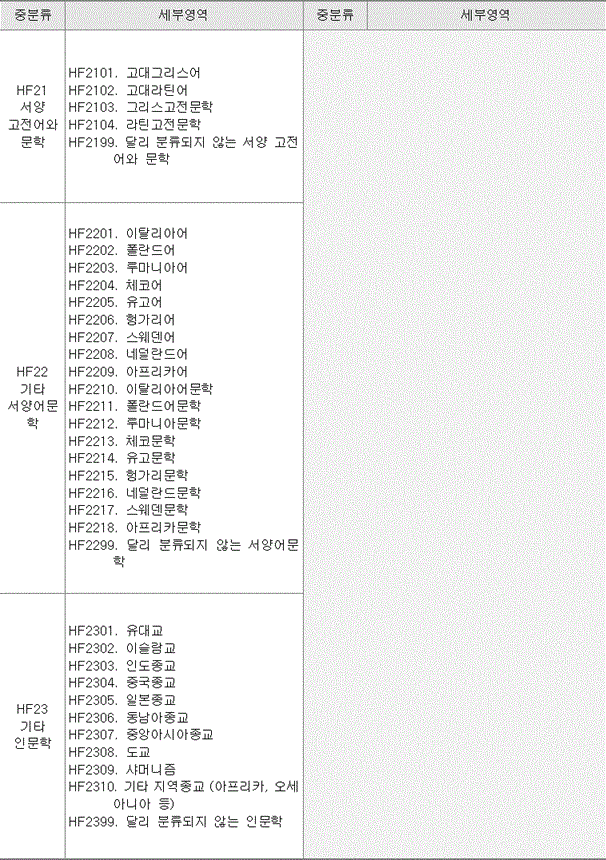

<details><summary>이미지 OCR 텍스트 (tesseract 자동인식 · 미검증 — 원문은 위 이미지)</summary>

```text
HF2101, 고대그리스어
바21 |바2102. 고대라틴어
서양 |HF2103, 그리스고전문학
고전어와 |HF2104. 라틴고전문학
문학 |HF2199. 달리 문휴되지 않는 서양 고전
어와 문학
HF2201, 이탈리아어
바2202. 폴란드어
HF2203. 루마니아어
HF2204, 체코어
HF2205. 유고어
바2206. 헝가리어
HF2207, 스웨덴어
HF2208. 네덜란드어
HF22 |HF2209. 아프리카어
기타 |HF2210. 이탈리아어문학
서양어문 HF2211. 폴란드어문학
학 | HF2212, 루마니아문학
HF2213. 체코문학
HF2214. 유고문학
HF2215, 헝가리문학
HF2216, 네덜란드문학
바2217. 스웨덴문학
바2218. 아프리카문학
HF2299. 달리 SRSA 않는 서양어문
학
HF2301. 유대교
HF2302. 이슬람교
바2303. 인도종교
바2304. 중국종교
바2305. 일본종교
버러  HF2306, 동남아종교
cm 12307. 증왕아시아종교
Ces |HF2308. 도교
HF2309, 샤머니즘
HF2310, 기타 지역종교 (아프리카, 오세
아니아 등)
HF2399, 달리 분류되지 않는 인문학
```

</details>

HG. 사회과학

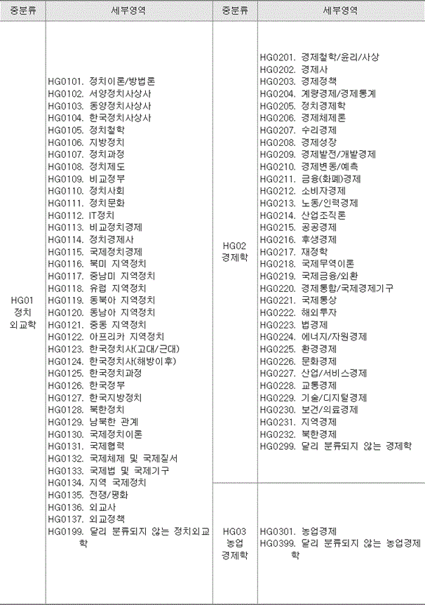

<details><summary>이미지 OCR 텍스트 (tesseract 자동인식 · 미검증 — 원문은 위 이미지)</summary>

```text
HGO201. 경제철학/윤리/사상
HGO202. 경제사
HGO101. 정치이론/방법론                 HGO203. 경제정책
HGO102. 서양정치사상사                  HGO204, 계랑경제/경제통계
HGO103. 동양정치사상사                 HGO205. 정치경제학
HGO104, 한국정치사상사                  HGO0206. 경제체제론
HGO105. 정치철학                     HGO207. 수리경제
HGO106. 지방정치                      HGO208. 경제성장
HGO107. 정치과정                      HGO209. 경제발전/개발경제
HGO108. BRAS                      HGO210. 경제변동/예측
HGO109. 비교정무                     HGO211. 금융(화페)경제
HGO110. 정치사회                     HGO212. 소비자경제
60111. 정치문화                     HGO213, 노동/인력경제
HGO112. |+정치                        HGO214. 산업조직론
HGO113. 비교정치경제                  HG0215. 공공경제
HGO114. 정치경제사              4602  HGO216. 후생경제
HGO115. 국제정치경제            경제학  HGO217. 재정학
HGO116. 북미 지역정치                 HGO218. 국제무역이론
60117. 중남미 지역정치                HGO0219, 국제금융/외환
HGO118. 유럽 지역정치                  HG0220. 경제롱합/국제경제기구
"1601 |HGO1I9. 동북아 지역정치               HGO221. 국제롱상
정치 |HGOI20. 동남아 지역정치                HGO222. 해외루자
외교학 HGO121. 중동 지역정치                 HG0223. 법경제
HGO122. 아프리카 지역정치               HG0224,. 에너지/자원경제
HGO123. 한국정치사(고대/근대)             "160225. 환경경제
HGO124. 한국정치사(해방이후)             HGO226. 문화경제
HGO125. 한국정치과정                   HGO227. 산업/서비스경제
HGO126. 한국정무                     HG0228. 교롱경제
HGO127. 한국지방정치                   HGO229. 기술/디지털경제
HGO128. 북한정치                    HGO230. 보건/의료경제
HGO129. 남묵한 관계                   HGO231. 지역경제
HGO130. 국제정치이론                  HGO232. 북한경제
HGO131. 국제협력                    HGO299. 달리 분류되지 않는 경제학
HGO132. 국제체제 및 국제질서
HGO133. 국제법 및 국제기구
HGO134. 지역 국제정치
HGO135. 전쟁/병화
HGO136. 외교사
HGO137. 외교정책
"60199. 달리 문류되지 않는 정치외교| "1603 |HGO301. 놓업경제
학                      놓업 |HGO399. 달리 SRSA 않는 SSSA
경제학       학
```

</details>

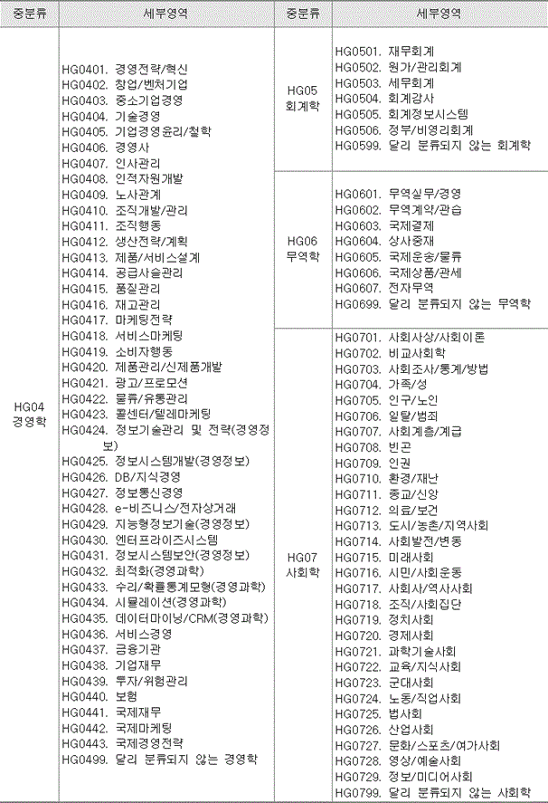

<details><summary>이미지 OCR 텍스트 (tesseract 자동인식 · 미검증 — 원문은 위 이미지)</summary>

```text
SEF            세부영역           MESS
HGO501. 재무회계
60401. 경영전략/혁신                   HGO502. 원가/관리회계
HG0402. 창업/벤처기업             1606 | 00503. 세루회계
"60403. 중소기업경영            회계학 」 20504. 회계강사
HG0404, 기술경영                     HGO505. 회계정보시스템
HG0405. 기업경영윤리/철학               HG0506. 정부/비영리회계
HGO406. 경영사                      HGO599. 달리 SRSA 않는 회계학
HGO407. 인사관리
60408. 인적자원개발
HGO409. 노사관계                     HGO601. 무역실무/경영
60410. 조직개발/관리                 1"1160602. 무역계약/관습
버(60411. 조직행동                    60603. 국제결제
HGO412. 생산전략/계획             HGO6 |HGO604. 상사중재
HG0413. 제품/서비스설계           무역학 |160605. 국제운송/물류
60414. 공급사술관리                  HGO606, 국제상품/관세
HGO415. 품질관리                     HGO607. 전자무역
HGO416, 재고관리                     HGO699. 달리 분류되지 않는 무역학
HGO417. 마케팅전략
60418. 서비스마케팅                    HGO7O1. 사회사상/사회이론
HGO419. 소비자행동                   HGO702, 비교사회학
HG0420. 제품관리/신제품개발              HGO703. 사회조사/통계/방법
HG0421. 광고/프로모션                   HGO704, 가족/성
\604  HG0422. 물류/유통관리                 HGO705. 원구/노인
경영학  버60423. 콜센터/텔레마케팅              HGO706. 일탈/범죄
©     HG0424. 정보기술관리 및 전략(경영정        HGO707. 사회계층/계급
보)                          HGO708. 빈곤
HGO0425. 정보시스템개발(경영정보)           HGO709,. 인권
HG0426. DB/AINSS                    HGO710. 환경/재난
HG0427, 정보통신경영                   HGO711. 총교/신앙
HG0428. 6@-비즈니스/전자상거래             HGO712. 의료/보건
HG0429. 지능형정보기술(경영정보)          HGO713. 도시/농촌/지역사회
HGO430. 엔터프라이즈시스템               HGO714. 사회발전/변동
60431. 정보시스템보안(경영정보)     "1607 |160715. 미래사회
HGO432. 최적화(경영과학)          사회학 |HGO716. 시민/사회운동
HG0433. 수리/왁률롱계모형(경영과학)        HGO717. 사회사/역사사회
HGO434. 시뮬레이션(경영과학)             HGO718. 조직/사회집단
HGO435. 데이터마이닝/0/((경영과학)        HGO719, 정치사회
HG0436. 서비스경영                     HGO720. 경제사회
HG0437. 금융기관                     HGO721. 과학기술사회
HG0438. 기업재무                     HGO722. 교육/지식사회
HG0439. 루자/위험관리                 HGO723. 군대사회
HG0440. 보험                      HGO724. 노동/직업사회
"60441. 국제재무                    HGO725. 법사회
HGO0442. 국제마케팅                   HGO726. 산업사회
HG0443. 국제경영전략                 HGO727, 문화/스포츠/여가사회
HGO499. 달리 문류되지 않는 경영학         HGO728. 영상/예솔사회
HGO729. 정보/미디어사회
HGO799. 달리 분류되지 않는 사회학
```

</details>

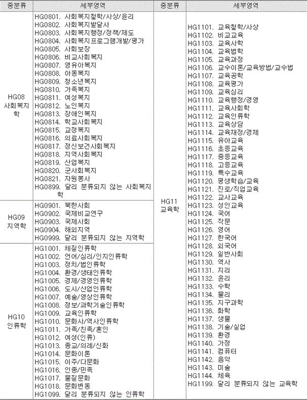

<details><summary>이미지 OCR 텍스트 (tesseract 자동인식 · 미검증 — 원문은 위 이미지)</summary>

```text
세부영역
학/사상
세부영역   /윤리            HG1101. aaa
중분류     rere 교육사학
HG0801.    복지발     제도           HG1103.    법학
19000. Nels                 61106 교<이로
0804.                          HG1 106.     학
HGOS0S. eee                   HG! 07, ROSS
HG0806. 비  아복지                  HG1108. aaa
HG0807. conn                     HG1 109. 나"
See een                   a ese
HGO809. caer                      HG1111. Bane
아아아 oie                    Mois sade
HG0811. 자수                    HG1113.  육재정/경제
HGOS      12. 자시                       114. 교
사회복   HGO813. 장 사회복지                 HG1115. ree
학   60814. 교정복지                    HG1116. S208
HGO815. 교 사회복지                 HG1117. Sens
HGO816. AWA                HG1118, eas
버(60817. 저어 islon                   HG1119. 명생학습/교육
HG0818. pee                      HG1120. heagus
HGO0819. 군사회복지                   HG1121. 교사교육
"60820. = At    는 사회목지      HG1122.  인교육
아이 Ga} 부류이지 않는        10911 gi 123 SS
"60899. 달                 MRE G1 124. 작문
학                       HG1125. 영어
HG0901. sews                  fat 126. Fok
i                     11  ㆍ
‘eooos, aahatal                    HaTI2e. 2130
HGO9 "| HG0903. ras    않는 지역학         relies 일반사회
on sae Be on a              Hat 130, 역사
0909. 달리 분류되지                 버나
vaio 언어/심리/인지인류학              rey 지리
161 02. 언어/심리 sat                HG1 132. 수학
비라 Sst 이르하                이아 울리
티키 005 oa sao ne                 HGTI36, 지구과학
H    ：  제/   는                  HG1135.   +
11006 ae ne                 01136. 화학
티키 00 Meats] aoe!             18113 기솔/싶업
8. 정보/                      Peal Tes  경
비해서 오피 나여사이크하               HG1139. 기정
HG1        문화사/역    시                                  HG1140,        러
HG10  HG1010. 가족/친족/혼인                 HG1141. 렁퓨
SS | GION. 여성(인류)                   HG1142. 음악
터리 미스 종교/의례/신화                 HG1143. oe       않는 교육학
HG1014.  ㅣ주/다문                    61199.
1015. 0    ES                     H
11016. 인종/인족
NGIOI? esis     않는 인류학
061099. 멀리 분류되지 않는
HG1099.
```

</details>

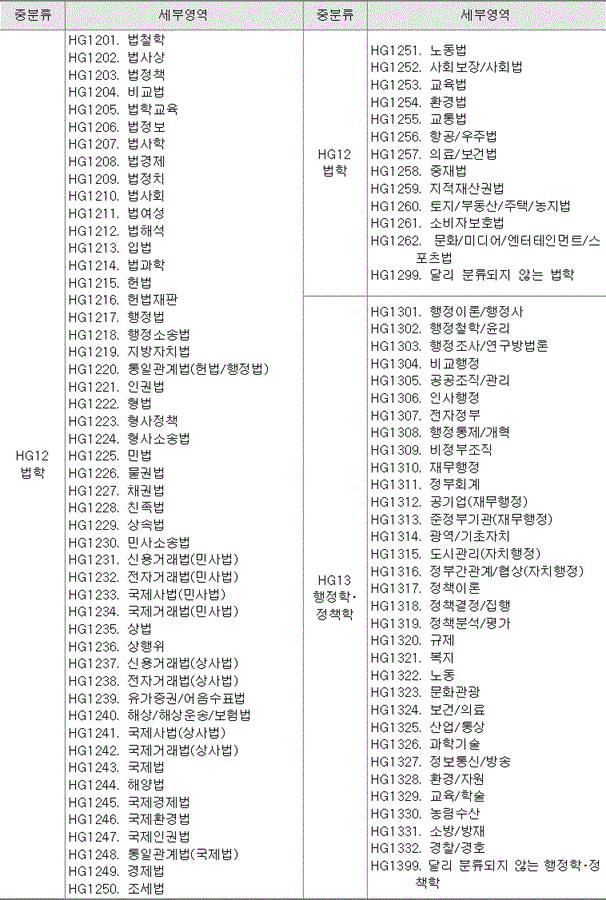

<details><summary>이미지 OCR 텍스트 (tesseract 자동인식 · 미검증 — 원문은 위 이미지)</summary>

```text
SER          세부영역
HG1201. 법철학
HG1251. 노동법
HG1202. 법사상                       HG1252. 사회보장/사회법
HG1203. 법정책                      HG1253, 교육법
HG1204. 비교법                       HG1254, 환경법
HG1 205. 법학교육                     HG1 255. 교통법
HG1206. 법정보                       HG1256, 항공/우주법
HG1207, 법사학                 "1612 |161257. 의료/보건법
HG1208. 법경제                 법학 |HG1258. 중재법
HG1209. 법정치                       HG1259, 지적재산권법
HG1210, 법사회                      HG1260. 토지/부동산/주택/농지법
HGI211. Bad                      HG1261. 소비자보호법
HG1212. Bais                  HG1262. 문화/미디어/엔터테인먼트/스
HG1213. 입법                             포츠법
HG1214, 법과학                      HG1299. 달리 분류되지 않는 법학
HG1215. 헌법
Gy}
nent ee                       HG1301, 행정이론/행정사
니퍼 가 행정소송법               HG1302, 행정철학/윤리
：    =                      HG1303. 행정조사/연구방법론
ol                                +    ~ Ce
ieee th                     HG1306. 인사행정
채색 a                    HG1307. 전자정부
：      고                      HG1308, 행정롱제/개혁
HG1224. 형사소송법                               parting
HG1309, 비정부조직
"1612 |HG1225. 민법                               pal
=                          HG1310. 재무행정
법학 |161226. 물권법                     HG1311, 정무회계
etoon ae                     HG1312. 공기업(재무행정)
91229 상속법                     HG1313. 준정부기관(재무행정)
"  230 ree                    HG1314. 광역/기초자치
아자이 Al soi SiC) AP)             HG1315. 도시관리(자치행정)
HG1231. 신      =                HG1316. 정부간관계/협상(자치행정)
HG1232. 전자거래법(민사법)         HGI3 |나61317. 정책이론
HG1233, 국제사법(민사법)         BSR: | cizis. 정책결정/집행
HG1234, 국제거래법(민사법)        정책학       eee
두 상범                   HG1319. 정책분석/평가
HG1238.                          HG1320. 규제
HG1237. 신용거래법(상사법)              HG1322. 노동
HG1238. 전자거래법(상사법)                    =
“                HG1323. 문화관광
HG1240. 해상/해상운송/보험법                    :
HG1325, 산업/통상
HG1241. 국제사법(상사법)                       ;
HG1326. 과학기술
HG1242. 국제거래법(상사법)                         이소
HG1327. 정보통신/방송
HG1243. 국제법
1244. 해양법                     HG1328. 환경/자원
HG1 244.                          HG1329. 교육/학술
HG1245, 국제경제법                    ci
HG1330. 농림수산
"61246. 국제환경법                             :
HG1331. 소방/방재
HG1247. 국제인권법                          경찰/경호
"61248. 통일관계법(국제법)           HGT S52.
erie                        HG1399, 달리 분류되지 않는 행정학-정
HG1249. 경제법                             책학
HG1250. 조세법
```

</details>

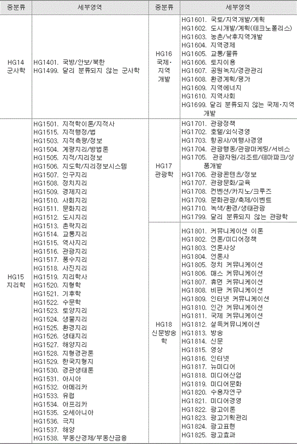

<details><summary>이미지 OCR 텍스트 (tesseract 자동인식 · 미검증 — 원문은 위 이미지)</summary>

```text
HG1601. 국토/지역개발/계획
HG1602. 도시개발/계획(테크노폴리스)
HG1603. 농촌/낙후지역개받
HG1604. 지역경제
"1616 61605. 교통/물류
"1614 |HG1401. 국방/안보/묵한           국제ㆍ 61606. 토지이용
군사학 61499. 달리 분류되지 않는 군사학    지역 | 161607. 공원녹지/경관관리
개발 |461608. 환경계획/평가
HG1609. 지역에너지
HG1610. 지역사회
HG1699. 달리 문류되지 않는 국제ㆍ지역
개발
HG1501. 지적학이론/지적사                HG1701. 관광정책
HG1515. 지적행정/법                   HG1702, 호텔/외식경영
HG1503. 지적측량/정보                  HG1703. 항공사/여행사경영
HG1504. 계향지리/방법론                 HG1704, 관광행동/관광마케팅/서비스
HG1505. 지적/지리정보               HG1705, 관광자원/리조트/테마파크/상
HG1506. 지도학/지리정보시스템       HG17        품개발
HG1507. 인구지리                관광학 |HG1706, 관광콘텐츠/정보
HG1508. 정치지리                      HG1707. 관광문화/교육
HG1509. 경제지리                      HG1708, 컨벤션/카지노/크루즈
61510. 사회지리                     HG1709, 문화관광/축제/이벤트
HGI511. 문화지리                    HG1710, 녹색/환경/생태관광
HG1512. 도시지리                     HG1799. 달리 문류되지 않는 관광학
초라
비하 이츠 ae                     HG1801. 커뮤니케이션 이론
HGIS15. 역사지리                     HG1802, 언론/미디어정책
161516. 관광지리                      NGI 805, SEAS
HG1517. 풍수지리                    HG1804. 언론사 _
HGIS |HG1519. 지리학사                    HG1806. 매스 커뮤니케이션
지리학 |HGI520. 지형학                      HG1807. 휴먼 커뮤니케이션
HGI521. 기후학                      HG1808. 비판 커뮤니케이션
HG1522. Set                      HG1809. 인터넷 커뮤니케이션
HG1524, 생물지리                     "161811. 국제 커뮤니케이션
HG1505. 환경지리             "1618 |HG1I812. 설득커뮤니케이션
그   Oo
HG1526. 생태지리               신문방송 "161813. 방송
                      학 _ |4161814. 신문
HG1527. 해양지리                             는 는
61528. 지형경관론                    "61815. 영상
HG1529. 한국지형지                    "\161816. 인터넷
HG1530. 경관생태론                    08101. 휴미디어
HG1531. 아시아                      "61818. 미디어산업
HG1533. 유럽                      HG1820, 수용자연구
HG1534. 아프리카                     HG1821. 미디어경영
HG1535. 오세아니아                    HG1822, 광고이론
HG1536. 극지                       HG1823. 광고기획관리
HG1537. 해양                         HG1824. 광고표현
```

</details>

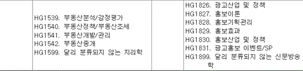

<details><summary>이미지 OCR 텍스트 (tesseract 자동인식 · 미검증 — 원문은 위 이미지)</summary>

```text
HG1826. 광고산업 및 정책
.    0
"61539. 부동산분석/감정평가             06162. Sele .
al                 HG1828, 흥보기획관리
"61540. 부동산정책/부동산조세
1161829. 홍보효과
HG1541. 무동산개발/관리                         사   ㅣ
HG1830. 홍보산업 및 정책
HG1542. 무동산중개                  HG1831, 광고홍보 이벤트/5ㄷ
. 달리 문류되지 않는 지리학              '    부류되지 않는 시무방송
HG1599. Sel =      =              HG1899. 달리 문류되지 않는 신문방송
학
```

</details>

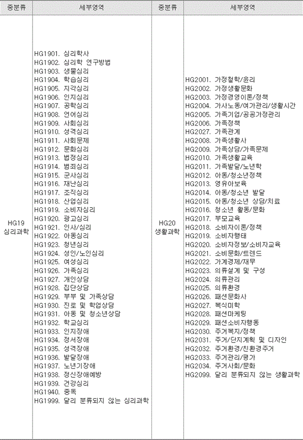

<details><summary>이미지 OCR 텍스트 (tesseract 자동인식 · 미검증 — 원문은 위 이미지)</summary>

```text
HG1901, 심리학사
HGI902, 심리학 연구방법
HG1903. 생물심리
HG1904. 학습심리                      HG2001. 가정철학/윤리
HG1905, 지각심리                      HG2002. 가정생활문화
HG1906. 인지심리                      HG2003. 가정경영이론/정책
"61907. 공학심리                     HG2004. 가사노동/여가관리/생활시간
HG1908, 언어심리                      HG2005, 가족기업/옹공가정관리
HG1909. 사회심리                      HG2006. 가족정책
HG1910. 성격심리                      "62027. 가족관계
HGI911, 사회문제                      HG2008, 가족생활사
61912. 문화심리                     HG2009, 가족상담/가족문제
HGI913. 법정심리                      HG2010. 가족생활교육
HG1914. 병죄심리                      HG2011, 가족발달/노년학
HGI915. 군사심리                    HG2012, 아동/청소년정책
HG1916. 재난심리                      HG2013. 영유아보육
61917. 조직심리                    HG2014, 아동/청소년 발달
HGI918. 산업심리                      HG2015, 아동/청소년 상당/치료
HG1919. 소비자심리                    HG2016. 청소년 활동/문화
HG1920. 광고심리                     HG2017. 부모교육
aay HG1921. 인사/심리            sears HG2018. 소비자이론/정책
HG1922. 아동심리                     HG2019. 소비자행태
HG1923. 청년심리                     HG2020, 소비자정보/소비자교육
HG1924, 성인/노인심리                  HG2021, 소비문화/트렌드
HG1925. 여성심리                      HG2022. 가계경제/재무
HG1926. 가족심리                     HG2023. RSA 및 구성
HG1927, 개인상담                      HG2024. 의류관리
HG1928. 집단상당                      HG2025, 의류환경
HG1929. 부부 및 가족상당                HG2026, 패션문화사
HG1930. 진로 및 학업상당                "62027. 목식미학
HG1931. 아동 및 청소년상담               HG2028. 패션마케팅
HG1932. 학교심리                      HG2029, 패션소비자행동
HG1933. 인지장애                     HG2030. 주거목지/정책
HG1934. 정서장애                      HG2031. 주거/단지계획 및 디자인
HG1935. 성격장애                     HG2032, 주거환경/친환경주거
HG1936. 발달장애                     HG2033. 주거관리/평가
HG1937. 노년기장애                   HG2034. 주거사회/문화
HG1938. 정신장얘예방                  HG2099, 달리 분쥬되지 않는 생활과학
HG1939. 건강심리
HG1940. 중독
HG1999. 달리 분류되지 않는 심리과학
```

</details>

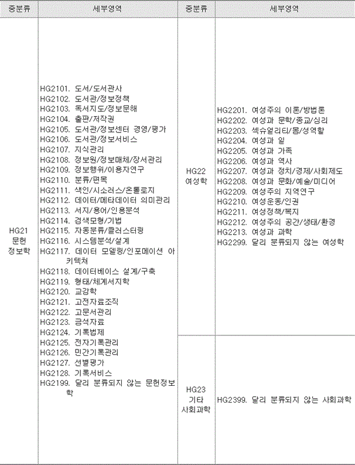

<details><summary>이미지 OCR 텍스트 (tesseract 자동인식 · 미검증 — 원문은 위 이미지)</summary>

```text
HG2101. 도서/도서관사
HG2102. 도서관/정보정책
HG2103. 독서지도/정보문해              HG2201. 여성주의 이론/방법론
HG2104. 출판/져작권                   HG2202. ASD 문학/종교/심리
HG2105. 도서관/정보센터 경영/평가          HG2203. 섹슈얼리티/몸/성역할
HG2106. 도서관/정보서비스              HG2204. 여성과 일
HG2107. 지식관리                      HG2205. 여성과 가족
HG2108. 정보원/정보매체/장서관리           HG2206. 여성과 역사
HG2109. 정보행위/이용자연구        HG22 |HG2207. 여성과 정치/경제/사회제도
HG2110. 문류/편목              여성학 HG2208. ASD 문화/예출/미디어
HG2111. 색인/시소러스/온롤로지            HG2209. 여성주의 지역연구
HG2112. 데이터/메타데이터 의미관리         HG2210. 여성운동/인권
HG2113. 서지/용어/인용분석               HG2211. 여성정책/목지
HG2114. 겸색모형/기법                  HG2212. 여성주의 공간/생태/환경
HG21 |HG2115. 자동문휴/클러스터렁              HG2213. 여성과 과학
문헌 _ "162116. 시스템분석/설계                HG2299, 달리 SRSA 않는 여성학
정보학 '9462117. 데이터 모델렁/인포메이션 oF
키텍쳐
HG2118. 데이터베이스 설계/구축
HG2119. 형태/제계서지학
HG2120. 교감학
HG2121. 고전자료조직
HG2122. 고문서관리
HG2123. 금석자료
HG2124. 기폭법제
HG2125. 전자기폭관리
HG2126. 민간기록관리
HG2127. ASB}
HG2128. 기폭서비스
HG2199. 달리 문휴되지 않는 SHAY
et                     HG23
기타 =|HG2399, Sel SRSA 않는 사회과학
사회과학
```

</details>

HH. 문화예술체육학

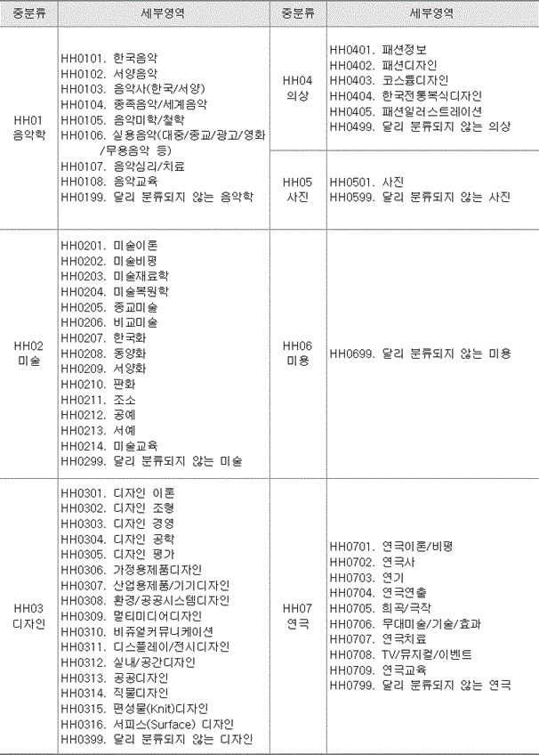

<details><summary>이미지 OCR 텍스트 (tesseract 자동인식 · 미검증 — 원문은 위 이미지)</summary>

```text
션
10101. 한국음악                      40402. 파션디자인
HHO102. 서양음악              바104 |HHO403. 코스를디자인
HHO103. 음악사(한국/서양)          의상 |바0404. 한국전통복식디자인
HHO1   HHO105. 음악미학/철학                   HHO499. 달리 문휴되지 않는 의상
음악학 (HHO. 싶용음악(대중/종교/광고/영화
/무용음악 등)
바10107. 음악심리/치료
10108. 음악교육               HHO5 |HHO501. 사진
HHOIS9. Sel SFRSIAl 않는 음악학  sz hm 달리 SRSA 않는 사진
바10201. 미술이론
HH0202. 미솔비평
HH0203. 미술재료학
HH0204, 미술목원학
HH0205. 중교미술
HH0206. 비교미술
HHO0207. 한국화
Wo? 10208. 동양화                Mia 1110699. 달리 문쥬되지 않는 미용
바10209. 서양화
HHO210. 판화
HHO211. 조소
HHO0212. 공예
바0213. 서예
HHO214. 미술교육
HH0299. 달리 분류되지 않는 미술
10301. 디자인 이론
HHO302. 디자인 조형
HHO303. 디자인 경영
HH0304. 디자인 공학                          연극
HHO305. 디자인 평가                   배바티: coe
HH0306. 가정용제품디자인            HHO703. 연기
HH0307, 산업용제품/기기디자인             HHO704, 연극연출
11105 |HH0S08. 환경/종종시스템디자인       HHO7 |HHO705, 8/2/22
디자인 | 10809. 뭘티미디어디자인           연극 |바10706. 무대미솔/기술/효과
—  |HHO310. 비쥬얼커뮤니케이션              10707. 연극치료
HHO311. 디스플레이/전시디자인             HHO708. ㅠ//뮤지컬/이벤트
HHO312. 실내/공간디자인                HHO709. 연극교육
바10313. 공공디자인                                   부      않는 연극
00914. 직훨디자인                   HHO799. 달리 분류되지 않는 연
HHO315. 편성물((000디자인
바10316. MW-A(Surface) 디자인
HHO309. 달리 문쥬되지 않는 디자인
```

</details>

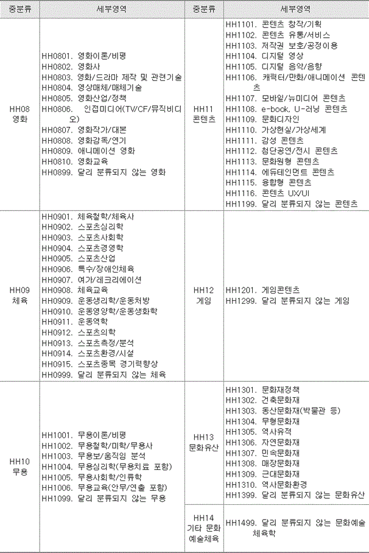

<details><summary>이미지 OCR 텍스트 (tesseract 자동인식 · 미검증 — 원문은 위 이미지)</summary>

```text
HH1101. 콘텐츠 창작/기획
HH1102, 콘텐츠 유롱/서비스
HH1103. HAH 보호/공정이용
HHO801. 영화이론/비평                 HH1104. 디지털 영상
HHO802. 영화사                      HH1105. 디지털 음악/음향
HHO803. 영화/드라마 제작 및 관련기술         HH1106. 캐릭터/만화/애니메이션 콘텐
버10804. 영상매체/매체기술                    츠
HHO805. 영화산업/정책                 HH1107, 모바일/뉴미디어 콘텐츠
HHO8 |HHO806. 인접미디어(1\다/뮤직비디        HH1108. e-book, U-as 콘텐츠
영화       오)                        HH1109, 문화디자인
HHO807. 영화작가/대본                  HH1110. 가상현실/가상세계
10808. 영화강독/연기                  HH1111. 감성 콘텐츠
HHO809. 애니메이션 영화                HH1112, 첨단공연/전시 콘텐츠
버10810. 영화교육                    HH1113. 문화원형 콘텐츠
바10899. 달리 문류되지 않는 영화           HH1114. 에듀테인먼트 콘텐츠
HH1115. S88 콘텐츠
HH1116, 콘텐츠 UX/Ul
HH1199. 달리 분류되지 않는 콘텐츠
버10901. 제육철학/체육사
버10902. 스포츠심리학
HHO903. 스포츠사회학
HHO904. 스포츠경영학
HHO905. 스포츠산업
바10906. 특수/장애인체육
버10907. 여가/레크리에이션
HHOS  |바10908. 체육교육               HH12 |HH1201. 게임콘텐츠
체육 _ 10909. 운동생리학/운동처방        게임 _ 11299. 달리 SRSA 않는 게임
바10910. 운동영양학/운동생화학
버10911. 운동역학
HHO912. 스포츠의학
HHO913. 스포츠측정/분석
HHO914. 스포츠환경/시설
바10915. 스포츠종목 경기력향상
HHO999. 달리 SRSA 않는 체육
HH1301. 문화재정책
HH1302. 건축문화재
HH1303. 동산문화재(박물관 등)
HH1304. 무형문화재
HH1001. 무용이론/비평           HH13  HH1308. 역사유적
HH1002. 무용철학/미학/무용사      문화유사 |HH1306. 자연문화재
HH1003. 무용보/움직임 분석              HH1307. 민속문화재
De HH1004. 무용심리학(무용치료 포함)         HH1308. 매장문화재
TS | HH1005. 무용사회학/인류학              베버908 Sela
아무/여                     ㆍ    =
11006, eee oe           HH1309, 달리 분류되지 않는 문화유산
바019 |니니1499. 달리 분류되지 않는 문화예술
기타 문화       체육학
예술체육
```

</details>

□ 인간 과학과 기술

OA. 뇌과학

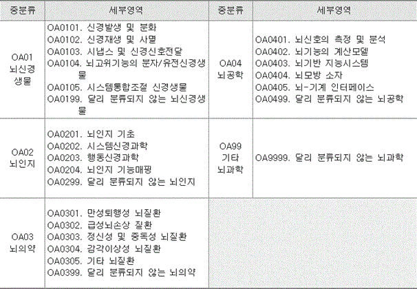

<details><summary>이미지 OCR 텍스트 (tesseract 자동인식 · 미검증 — 원문은 위 이미지)</summary>

```text
855 | re Se           Meee
04&0101. 신경발생 및 Sst
OA0102. ABA 및 사멸                 0A0401. 뇌신호의 측정 및 분석
05201   OA0103. AA 및 신경신호전달             OA0402. 뇌기능의 계산모델
뇌신경  OA0104, 뇌고위기능의 분자/유전신경생| 0&04 04&0403. 뇌기반 지능시스템
생물        물                       뇌공학 ㅣ0&0404. 뇌모방 소자
0&0105. 시스템통합조절 신경생물            OA0405. 뇌-기계 인터페이스
OA0199. Se] 문휴되지 않는 뇌신경생        OA0499. 달리 분류되지 않는 뇌공학
=
OA0201. 뇌인지 기초
6402 |0A0202. 시스템신경과학             06899
뇌인지  OA0203. 행동신경과학             기타 _ 09999. Se] 문류되지 않는 뇌과학
-    OA0204. 뇌인지 기능매펑            뇌과학
OA0299. 달리 문류되지 않는 뇌인지
OA0301. 만성퇴행성 뇌질환
00302. 급성뇌손상 질환
OA03 |0&0303. AAA 및 중독성 뇌질환
뇌의약 | OA0304. 감각이상성 뇌질환
06&60305. 기타 뇌질환
OA0399. 달리 문류되지 않는 뇌의약
```

</details>

OB. 인지/감성과학

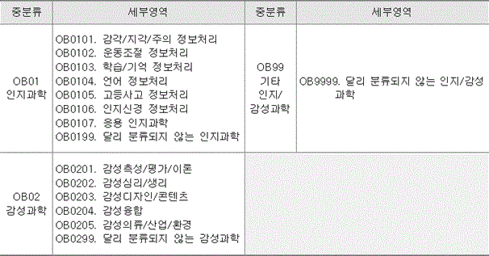

<details><summary>이미지 OCR 텍스트 (tesseract 자동인식 · 미검증 — 원문은 위 이미지)</summary>

```text
060101. 감각/지각/주의 정보처리
060102. 운동조절 정보처리
060103. 학습/기억 정보처리          0699
0601 (OB0104. 언어 정보처리             기타 _|069999. 달리 문휴되지 않는 인지/감성
인지과학 1060105. 고등사고 정보처리         인지/       과학
060106. 인지신경 정보처리         강성과학
060107. 용용 인지과학
060199. 달리 문휴되지 않는 인지과학
060201. 강성측성/평가/이론
060202. 감성심리/생리
0602 060203. 감성디자인/콘텐츠
강성과학 10560204. 감성융합
OB0205. 감성의류/산업/환경
060299. 달리 SFRSIAl 않는 감성과학
```

</details>

OC. 과학기술과 인문사회

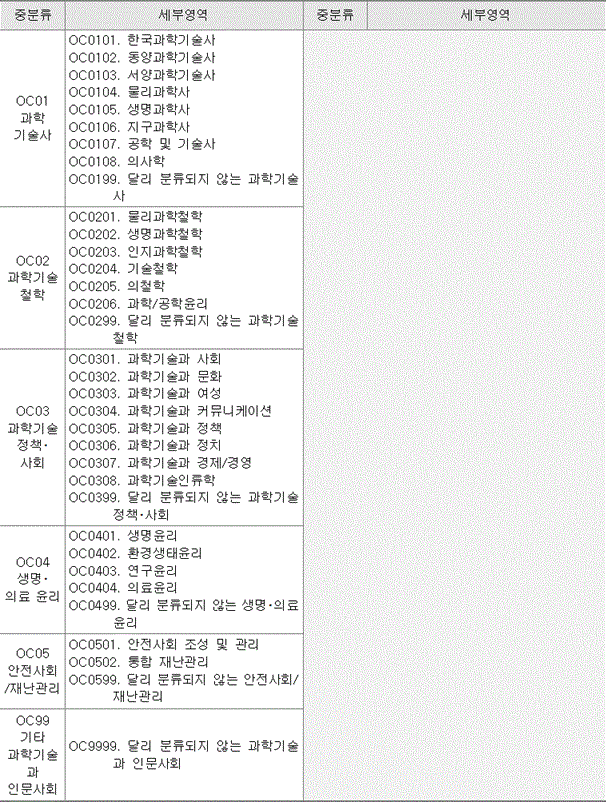

<details><summary>이미지 OCR 텍스트 (tesseract 자동인식 · 미검증 — 원문은 위 이미지)</summary>

```text
000101. 한국과학기술사
OCO102. SD! Sat
OCO103. 서양과학기술사
cco |000104. 물리과학사
사비] |000105. 생명과학사
seat ㅣ060106. 지구과학사
000107. 공학 및 기술사
OC0108. 의사학
000199. 달리 분류되지 않는 과학기술
사
OC0201, 물리과학철학
OC0202, 생명과학철학
0C0203. 인지과학철학
nee 000204. 기솔철학
정할. |060205. 의철학
000206. 과학/공학윤리
0C0299. 달리 분류되지 않는 과학기술
ee
000301. 과학기술과 사회
0C0302, 과학기솔과 문화
060303. 과학기술과 여성
00603 |0C0304. 과학기술과 커뮤니케이션
과학기솔 |0060305. 과학기술과 정책
정책 ，」000306. 과학기술과 정치
사회 |000307. 과학기술과 경제/경영
0C0308, 과학기술인류학
0C0399. 달리 문류되지 않는 과학기술
정책ㆍ사회
000401. 생명윤리
0060402. 환경생태윤리
fag. |000403. 연구윤리
"， 10C0404. 의료윤리
의료 윤리               =         느
060499. 달리 분류되지 않는 생명ㆍ의료
윤리
ocos ㅣ000501. 안전사회 조성 및 관리
orm nya 00502. 통합 재난관리
Fryctatay 000599. 달리 분류되지 않는 안전사회/
난관     재난관리
0699
그지 g |009999. 달리 분류되지 않는 과학기술
과 인문사회
과
인문사회
```

</details>

2. 적용분야

X. 공공분야

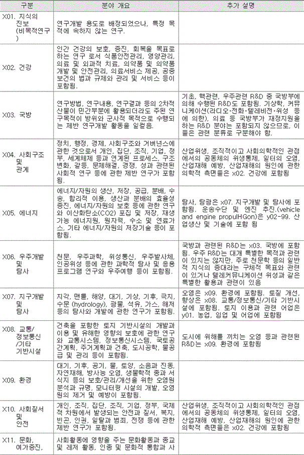

<details><summary>이미지 OCR 텍스트 (tesseract 자동인식 · 미검증 — 원문은 위 이미지)</summary>

```text
구분           추가 설명
×01. 지식의
진보      연구개발 SSS 배정되었으나, 특정 목
(비목적연구 | 적에 속하지 않는 연구.
)
인간 건강의 보호, 중진, Iss Se
하는 연구 로서 식품안전관리, 영양관리,
yoo 건강  |의료 및 외과적 치료, 의약품 및 의약품
ㆍ 어학 | 개발 및 안전관리, 의료서비스 제공, 공중
보건의 법과 AMIS 관리 및 서비스 등이
포함됨.
_ | 기초, 핵관련, 우주관련 RED 중 국방무에
연구방법, 연구내용, APBD Sol 2차적 | 의해 수행된 REDS BAS! 기상학, 커뮤
yon ay «| NEO! 민간부분에 활용되더라도 주된 연 | 니케이션(라디오ㆍ전화:텔레비전ㆍ위성 등
         구목적이 방위와 군사적 목적으로 수행되 | 에 의한), 의료 등 SVP} 재정지원을
는 제반 연구개발 활동을 Ves,       하는 R&D 문아는 포함되지 않으므로, 이
들은 관련 SRS 구분해야 함.
정치, 행정, 경제. 사회구조와 거버년스에
0 APE | 관한 것으로서 개인, 집단, 조직, 기업. 정 | 산업위생, 조직적이고 사회의학적인 관점
ht | 부, 세계체제 등과 연계된 프로세스, 구조 | 에서의 공동체의 위생통제, 일터의 오염,
고기      변화, 갈등, 문제해결, 경쟁, 성과 관련된 | 산업재해 예방, 산업재해의 원인에 관한
        사회적 연구 SOL 관한 제반 연구가 포함 | 의학적 SASS x02 Aol FE
에너지/자원의 생산, 저장, 공급. 분배, 수
웅진. 에녀지/자원의 보호 등에 관한 연구 | SAL SBS 07 PAW 및 탐사에 포
X05. 에너지  |｜와 이산화탄소(002) 포집 및 저장, 재생 | BS SSTe 및 OA Ae. vehicle
가능 에너지원. 원자력, 수소 및 연료가  and engine propulHGon)= y02-99. at
스 기타 에너지/자원의 져장기을 중이 포  ss = e025
U0 관련된 RADE 06. 3801 포함
ay |B. 우주 680는 대개 특별한 목적과
즈      처무   즈         시   주    ,  =    i   ow     ”“  S  그  ——
Mgr PE 인공위성 So 관한 과학적 탐사 및 oe | 이 Wis 않지만, 주로 천문학 등의 Ve
en       프로그램 ATA 우주여행 중이 BBS. | | 있거나 텔레커뮤니케이션 위성과 갈은
특별한 활용과 관련이 있음
SSS x09. 환경에 BBS. 토질 개선,
Or GONE | BS 00000. 28, 석유 가스 해져 | SIE %06: 교통/영보통신/기타 기반시
탐사      동의 탕사와 개발에 관한 연구과 Bere, | 소이 오아 이아 및 Sol gee
'        0     8     의 보                        =
정보통신                        다 한 연고 | 도시에 위해를 끼치는 오염 등과 관련된
와 교통시스템, 정보통신시스템, Rew | Sel
cera | 감계획, 주거계획과 건축, 도시공학, 물공 | RADE x09 환경에 BBS
.       급 및 관리 등이 BBE.
대기, 기후, 공기, S 토양, AST 진동
자연재해, 방사능 오염, 생물학적 중과 서
XO. 환경 | AK) 등의 보호/관리/개선을 위한 오영원
분석과 규명, 모니터링 시설의 개발, 오염
원의 제거 및 예방이 포함됨.
x10 사회질서 | 개인, 조직, 집단, 조직. 기업, 정부, 국제 | 산업위생, 조직적이고 사회의학적인 관점
gt        적 차원에서 발생되는 안전과 질서, 복지, | 에서의 공동체의 위생통제, 일터의 오영,
로       빈곤, 인권, 일탈과 범죄, 전쟁 등에 관한 | 산업재해 예방, 산업재해의 원인에 관한
안전       제반 연구가 Bere               의학적 측면들은 x02, 건강에 ZS
×11. 문화, | 사회활동에 영향을 주는 문화활동과 Sa
여가중진, [Fad 활동, 인종 및 문화적 롱함과 사
```

</details>

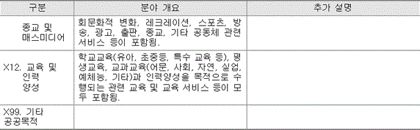

<details><summary>이미지 OCR 텍스트 (tesseract 자동인식 · 미검증 — 원문은 위 이미지)</summary>

```text
구분            주가 설명 00000. 0
종교 및. | 옹 광고. 출판. 종교. 기타 공동체 관련
송,    내   —s    ㆍ        B®  민의 ee
매스미디어 | Gua Sol 포함될.
학교교육(유아, 초중등, 특수 교육 등), 평
X12. 교육 및 | MDS DIAS. 사회, 자연, 실업,
인력       예체능, 기타)과 인력양성을 목적으로 수
양성     행되는 관련 교육 및 교육 서비스 등이 모
두 포함됨.
X99. 기타
Ser |
```

</details>

Y. 산업분야

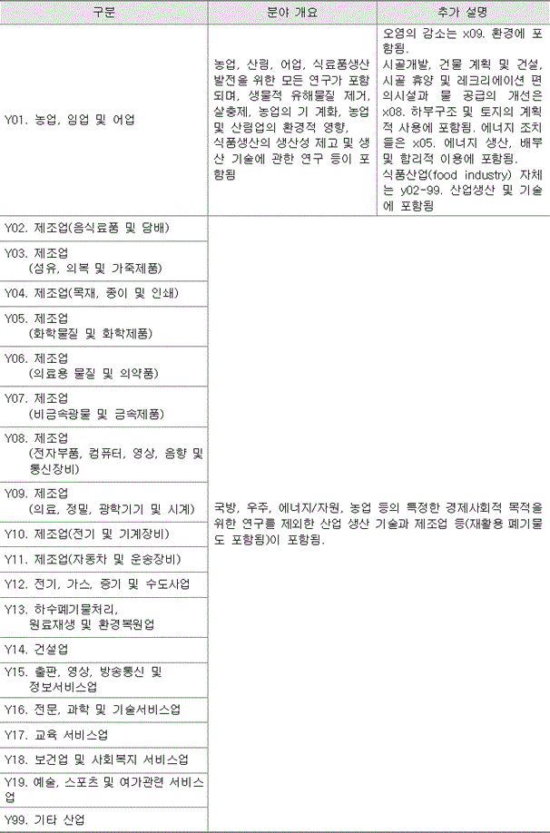

<details><summary>이미지 OCR 텍스트 (tesseract 자동인식 · 미검증 — 원문은 위 이미지)</summary>

```text
.     See   추가 설명
오염의 감소는 x09. 환경에 포
2g.
SQ, AB, 어업, 식료품생산 | 시골개발, 건물 계획 및 건설,
PAS 위한 모든 AP 포함 AL 휴양 및 레크리에이션 편
되며, 생물적 유해물질 제거, |의시설과 물 공급의 개선은
살충제, 놓업의 기 계화, 놓업 x08. 하무구조 및 토지의 계획
Vol. $8, 임업 및 어업          및 산령업의 환경적 영향, | A 사용에 포항됨. 에너지 조치
식품생산의 생산성 제고 및 생 | 들은 ×05. 에너지 생산, 배부
At 기술에 관한 연구 등이 포 | 및 합리적 이용에 FHS.
2g                 식품산업(1600 industry) 자제
는 yO2-99, 산업생산 및 기솔
에 FHS
02. 제조업(음식료품 및 담배)
YO3. 제조업
(섬유, 의복 및 가죽제품)
04. 제조업(목재, Bol 및 인쇄)
05. 제조업
(화학물질 및 화학제품)
06. 제조업
(의료용 물질 및 의약품)
07. 제조업
(비금속광물 및 금속제품)
708. 제조업
(전자부품, 컴퓨터, 영상, 음향 및
통신장비)
09. 제조업
(의료, 정밀, 광학기기 및 시계) | BB. 우주, 에너지/자원, SY Sol 특정한 경제사회적 목적을
+a  제외한 산업 생산 2  제조업 Sx   기물
110. 제조엽(전기 및 기계장비) | Enea ey NAS SORES BIE
11. 제조업(자동차 및 운송장비)
12. 전기, 가스, 중기 및 수도사업
13. 하수폐기물처리,
원료재생 및 환경목원업
14. 건설업
15. 출판, 영상, Besa 및
정보서비스업
16. 전문, 과학 및 기술서비스업
17. 교육 서비스업
18. 보건업 및 사회목지 서비스업
19. 예술, 스포츠 및 여가관련 서비스
업
99. 기타 산업
```

</details>

부칙 <제2025-60호, 2025. 12. 16.>

제1조(시행일) 이 고시는 발령한 날부터 시행한다.
